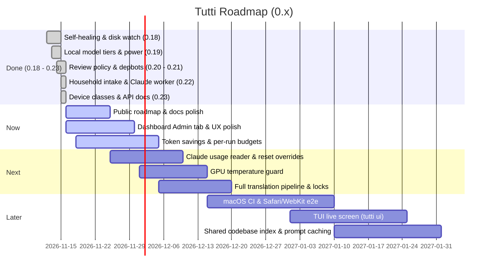

# Tutti Roadmap

*Tutti* (music): everyone plays together. This roadmap summarises what is in flight, what comes next, what is planned for later, and what has shipped recently (current release: **v0.23.6** — see [CHANGELOG.md](CHANGELOG.md) and the detailed notes in [docs/ROADMAP.md](docs/ROADMAP.md)).

**Status legend:**
`🟢 Done` · `🔵 In progress` · `🟡 Planned` · `⚪ Later`

---

## Timeline

---

## Now

- 🔵 **Public Roadmap & Documentation Polish** — Root `ROADMAP.md` with Now / Next / Later / Done sections and timeline, kept in sync with [docs/ROADMAP.md](docs/ROADMAP.md) and [CHANGELOG.md](CHANGELOG.md). (`backlog: t216`)
- 🔵 **Dashboard Admin Tab & Chat Workspace** — Dedicated Admin tab, prompt queue, per-message agent/effort controls, and live context panel in the web dashboard ([docs/DASHBOARD.md](docs/DASHBOARD.md), [docs/CHAT.md](docs/CHAT.md)). (`plan:` [docs/ROADMAP.md](docs/ROADMAP.md#owners-product-vision-2026-11-14-night))
- 🔵 **Token Savings & Per-Run Budgets** — Extend automatic compaction (`autocompact.threshold_pct`) with per-run token budgets and early stop as CLIs expose token counts ([docs/USAGE-PACING.md](docs/USAGE-PACING.md)). (`plan:` [docs/ROADMAP.md](docs/ROADMAP.md#owners-product-vision-2026-11-14-night))

## Next

- 🟡 **Claude Usage Reader & User-Editable Resets** — Automatic Claude `get_usage` / `ccusage` readers and `tutti usage set-reset <account> <when>` overrides ([docs/USAGE-PACING.md](docs/USAGE-PACING.md)). (`plan:` [docs/ROADMAP.md](docs/ROADMAP.md#next-02))
- 🟡 **GPU Temperature Guard** — Add GPU temperature monitoring alongside the existing CPU heat guard (`machines.<m>.heat`) ([docs/MACHINES.md](docs/MACHINES.md)). (`plan:` [docs/ROADMAP.md](docs/ROADMAP.md#later))
- 🟡 **Full Translation Pipeline & Named Locks** — Multi-stream `flock` queue, second judge, per-locale glossary/register in `tutti translate`, plus `tutti lock <name> -- <cmd>` for shared resources. (`plan:` [docs/ROADMAP.md](docs/ROADMAP.md#next-02))
- 🟡 **Machine-Readable `--json` Output** — Consistent `--json` output across `machines`, `usage`, and `workers` commands. (`plan:` [docs/ROADMAP.md](docs/ROADMAP.md#later))

## Later

- ⚪ **macOS Support & CI Verification** — GitHub Actions macOS runners (Apple Silicon & Intel) for the one-line installer, CLI smoke, unit tests, and Safari/WebKit PWA e2e tests. (`plan:` [docs/ROADMAP.md](docs/ROADMAP.md#macos-release-project-website-telemetry-owner-2026-11-14))
- ⚪ **Live TUI (`tutti ui`)** — Keyboard-first terminal screen over SSH sharing the dashboard's data layer. (`plan:` [docs/ROADMAP.md](docs/ROADMAP.md#an-excellent-tui-now-a-gui-next-owner-2026-11-14))
- ⚪ **Shared Codebase Index & Prompt Caching** — One shared index and cached briefs across agents to cut repeated token spend. (`plan:` [docs/ROADMAP.md](docs/ROADMAP.md#ideas-borrowed-from-the-best-ai-dev-tools-2026))
- ⚪ **Checkpoints, Rewind & Best-of-N** — Per-step file snapshots with rollback and cost-capped parallel worker runs. (`plan:` [docs/ROADMAP.md](docs/ROADMAP.md#ideas-borrowed-from-the-best-ai-dev-tools-2026))

## Done

- 🟢 **Autopilot Panic Takeover (`v0.23.6`)** — Other accounts fill up to their own panic line while the main agent is in panic, and owner-core load no longer throttles online runs. ([PR #608](https://github.com/ventura8/Tutti/pull/608), [PR #602](https://github.com/ventura8/Tutti/pull/602), `backlog: t173`)
- 🟢 **Generated API Reference (`v0.23.5`)** — Complete CLI, HTTP, MCP, and config reference in [docs/API.md](docs/API.md), checked against the code in CI. ([PR #603](https://github.com/ventura8/Tutti/pull/603))
- 🟢 **Device Classes, Kept Prep & Windows Desktop Runs (`v0.23.0`)** — Per-class adb deny lists, restored device settings, project runners, and interactive Windows UI sessions ([docs/DISPATCH.md](docs/DISPATCH.md)). ([PR #594](https://github.com/ventura8/Tutti/pull/594), [PR #597](https://github.com/ventura8/Tutti/pull/597))
- 🟢 **Household Intake & Claude Worker (`v0.22.0`)** — Session MCP tools, `tutti run claude`, and the **Work outside Tutti** intake guard ([docs/INTAKE.md](docs/INTAKE.md)). ([PR #593](https://github.com/ventura8/Tutti/pull/593), `backlog: t156`)
- 🟢 **Dependency & Security Intake (`v0.21.0`)** — Dependabot, Cursor, and code-scanning alerts turned into autopilot tasks ([docs/SECURITY-INTAKE.md](docs/SECURITY-INTAKE.md)). ([PR #587](https://github.com/ventura8/Tutti/pull/587))
- 🟢 **Review Policy & Local Model Tiers (`v0.19.0` – `v0.20.0`)** — Rate-limit review policies, measured machine power, local model tiers, and secret-free process environments ([docs/FLEET.md](docs/FLEET.md), [docs/ENERGY.md](docs/ENERGY.md)). ([PR #581](https://github.com/ventura8/Tutti/pull/581), [PR #585](https://github.com/ventura8/Tutti/pull/585), [PR #583](https://github.com/ventura8/Tutti/pull/583), `backlog: t116`)
- 🟢 **Self-Healing & Disk Watch (`v0.18.0`)** — Expiring yield flags, hung WSL restarts, and daily disk clean-up ([docs/SELFHEAL.md](docs/SELFHEAL.md)). ([PR #582](https://github.com/ventura8/Tutti/pull/582))
