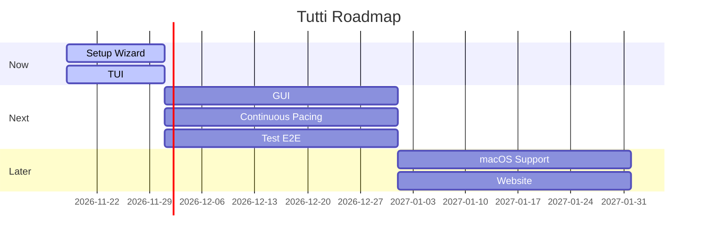

# Tutti Roadmap

Tutti is a toolkit for coordinating AI agents, local agents, and machines. This roadmap tracks our progress, prioritized for documentation and usability.

## Now 🚀
- ✅ **Setup Wizard (`tutti setup`)**: Minimum input, idempotent, `tutti doctor` checks, sign-ins, permissions, machine detection. (Top priority) [[docs/INSTALL.md](docs/INSTALL.md)] [Backlog: t1]
- ✅ **TUI (`tutti ui`)**: One live screen for sessions, machines, test queue, accounts, etc. Keyboard-first, works over SSH. [[docs/DASHBOARD.md](docs/DASHBOARD.md)] [Backlog: t2]

## Next 🏗️
- ⏳ **GUI (Web App)**: Material Design, PWA, serving the TUI's data layer. [[docs/DASHBOARD.md](docs/DASHBOARD.md)] [Backlog: t3]
- ⏳ **Continuous Pacing**: Even burn for all accounts, correcting in real-time, switching to cheaper agents/local models when ahead. [[docs/USAGE-PACING.md](docs/USAGE-PACING.md)] [Backlog: t4]
- ⏳ **`tutti test`**: End-to-end verification of the toolkit on local and remote machines. [[docs/TESTING.md](docs/TESTING.md)] [Backlog: t5]
- ⏳ **Peer Coordination**: `tutti peers` for sharing plans, quota, machine yields, and QA findings. [Backlog: t6]

## Later 📅
- 📅 **macOS Support**: Full support, including e2e tests on GitHub Actions. [Backlog: t7]
- 📅 **Heat Guard**: GPU temperature monitoring for safety. [[docs/MACHINES.md](docs/MACHINES.md)] [Backlog: t8]
- 📅 **Project Website**: GitHub Pages site with docs and auto-detect installers. [Backlog: t9]
- 📅 **Telemetry**: Opt-in, privacy-first analytics and Sentry crash reporting. [[docs/TELEMETRY.md](docs/TELEMETRY.md)] [Backlog: t10]

## Done ✅
- ✅ **Core Orchestration**: Extraction from the first project, `tutti run`, `tutti test`. [[docs/ARCHITECTURE.md](docs/ARCHITECTURE.md)] [Backlog: t11]
- ✅ **Machine Guards**: Memory, heat (CPU), slot management. [[docs/MACHINES.md](docs/MACHINES.md)] [Backlog: t12]
- ✅ **Intake Guard**: Tracking work outside Tutti. [[docs/INTAKE.md](docs/INTAKE.md)] [Backlog: t13]
- ✅ **Security Audit Follow-ups**: Requirements with hashes, secure keys, etc. [[docs/SECURITY-AUDIT-2026-11.md](docs/SECURITY-AUDIT-2026-11.md)] [Backlog: t14]
- ✅ **Self-Healing**: Automatic repairs for dependencies, CLIs, tunnels, state files. [[docs/SELFHEAL.md](docs/SELFHEAL.md)] [Backlog: t15]

---

## Timeline

