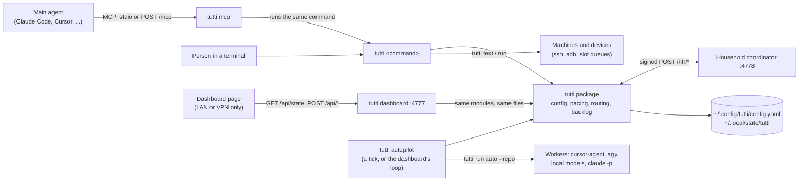

# API reference

Every public surface of Tutti in one place: the `tutti` command, the dashboard's HTTP API, the household coordinator's
calls, the MCP server, the config file and the Python package. The CLI, MCP and config parts are generated from the code
(`python3 -m tutti.apidoc --write`); `tests/test_apidoc.py` fails when a CLI subcommand, an HTTP route or an MCP tool exists
in the code but not here, or when a generated part is stale. For HTTP routes only their presence is checked (each must open a table row); their methods,
roles and JSON shapes below are written by hand from the handlers.

Hosts in the examples are generic (`127.0.0.1`, `build1.example`); tokens are placeholders. Nothing here is a real address.

- [How the parts relate](#how-the-parts-relate)
- [Exit codes](#exit-codes)
- [The dashboard HTTP API](#the-dashboard-http-api)
- [The household coordinator](#the-household-coordinator)
- [The MCP server](#the-mcp-server)
- [The config file](#the-config-file)
- [Python modules](#python-modules)
- [The CLI](#the-cli)

## How the parts relate



The CLI is the one implementation: every MCP tool runs a `tutti` command and returns what it prints; the dashboard calls
the same modules and writes the same config and state files; the autopilot is a tick of `tutti autopilot` that the
dashboard also runs on its timer.

## Exit codes

Every `tutti` command uses the same codes:

| Code | Meaning |
| --- | --- |
| 0 | Done. |
| 1 | Failed, with the reason and the next step on stderr (a config error, a refused ship, a missing task, a failed check). |
| 2 | Refused before it started: wrong arguments (argparse), an unknown name, a public address for a server. |
| 3 | Nothing to do it with: no worker has room (`run auto`), a test target that cannot be picked, a page still loading. |
| 4 | `tutti pr review`: a reviewer the policy waits for (`review.coderabbit` or `review.greptile`: `wait`) is rate-limited; nothing merged, ask again later. |
| 75 | This machine is not the active main machine now (docs/FAILOVER.md): a client tries the next one. |
| 124 | `tutti wait`: the thing waited for did not appear within `--timeout`. |
| 125 | `tutti wait`: the job looks stalled (`--stall`). |
| 130 | Interrupted (Ctrl-C). |
| other | `tutti test`, `tutti rsh` and `tutti run` return the exit code of the command or worker they ran. |

## The dashboard HTTP API

`tutti dashboard` serves the page and its JSON API on `127.0.0.1:4777` (`dashboard.port`, `dashboard.bind`).

**Never on the internet.** The server drops a connection whose peer has a public address before reading it: it answers
loopback and the private ranges (RFC 1918, 100.64.0.0/10, fc00::/7), so a LAN or a VPN, and a port forward to it is refused.
The check is on the immediate peer only: a reverse proxy on this computer or the LAN that forwards public traffic would pass
it (sign-in still applies), so never put the dashboard behind a public proxy or tunnel. Binding to another address than loopback, or naming `dashboard.origins`, needs sign-in (`tutti auth setup`): the
dashboard refuses to start otherwise.

### Requests and answers

- Every answer is JSON (`Content-Type: application/json`) except the page, its static files and the chat's stream.
  An error is `{"error": "<what happened, why, and what to do>"}` with a 4xx or 5xx status.
- `Host` must be one of the dashboard's own addresses (else 403), so DNS rebinding cannot reach it.
- A POST must come from the page itself: `Origin` is the dashboard's, `Sec-Fetch-Site` is `same-origin` when sent,
  `Content-Type: application/json` (else 415), and `X-Tutti-Token` carries the page's token: a per-start token written
  into the page without sign-in, the session's CSRF token with sign-in. A body is at most 4 KB unless the route says more
  (Settings 64 KB, the chat more), else 413.
- **Roles** (with sign-in on, docs/AUTH.md): `pending` sees nothing; `viewer` reads and may POST only the routes marked
  *viewer*; `admin` may do everything. Without sign-in the dashboard serves only this computer's login, whose user is the
  admin. A route marked *admin* answers 403 to a viewer; a route marked *self* checks per action (one's own data, or an
  admin for anyone).
- Unauthenticated with sign-in on: 401 for the API, the sign-in page for a page.

### Reading

| Route | Method | Who | Answer |
| --- | --- | --- | --- |
| `/api/state` | GET | viewer | The whole dashboard as one object (keys below). Sent with an `ETag`; `If-None-Match` gets a 304 when nothing changed; gzip when asked. |
| `/api/health` | GET | anyone | `{"ok": true, "started": <epoch>, "host": "<hostname>", "version": "0.23.5"}`; `started` changes on a restart. |
| `/api/settings` | GET | admin | The Settings tab: sections, fields with value, default and source, `etag` of the file, diverging copies. |
| `/api/vpn/status` | GET | viewer | The private network card: `{"state": ..., ...}`, 200 also when no VPN is set up. |
| `/api/needs` | GET | viewer (self) | The viewer's own open questions (an admin: everyone's) and notify settings. |
| `/api/welcome` | GET | viewer (self) | The viewer's own "welcome back" summary. |
| `/api/auth/me` | GET | anyone | `{"enabled": false, "setup": "tutti auth setup"}` without sign-in; with it `{"enabled": true, "client_id", "device", "first", "signed_in", ...user}`. |
| `/api/auth/users` | GET | admin | `{"users": [...], "invites": [...], "audit": [...]}`. |
| `/api/me/schedule` | GET | viewer (self) | `{"sub": "<id>", "schedule": {...}}`: one's own pacing schedule. |
| `/helper` | GET | admin | The reading helper page (bookmarklets that post usage readings). |
| `/settings` | GET | admin | The Settings page. |
| `/login` | GET | anyone | The sign-in page (Google). |
| `/invite` | GET | anyone | The page an invite link opens. |

`/api/state` keys: `autopilot`, `config`, `controls`, `devices`, `disk`, `dispatch`, `failover`, `fleet`, `generated_at`,
`household`, `household_use`, `hygiene`, `jobs`, `local_models`, `machines`, `main`, `outside`, `presence`, `probe_error`,
`projects`, `queue`, `refresh_seconds`, `releases_stuck`, `scouts`, `security`, `selfheal`, `setup`, `summary`,
`telemetry`, `updates`, `usage`, `version`, `where`, `work_browser`, `work_queue`, `workers`. The page tolerates new keys;
treat them as additive.

```bash
curl -s http://127.0.0.1:4777/api/health
# {"ok": true, "started": 1763300000.0, "host": "laptop", "version": "0.23.5"}
```

### Changing (admin)

Each is a POST with a JSON body; the answer is `{"ok": true, ...}` with 200 (202 when it started in the background).

| Route | Body | Answer and errors |
| --- | --- | --- |
| `/api/reading` | `{"account": "claude", "used": 42, "resets": "2026-11-20T08:00Z", "note": ""}` (`resets`, `note` optional; the reading helper adds `key`) | Writes the usage log like `tutti usage log`. 400: unknown account, `used` outside 0-100, a reset more than a day ago or two months ahead; 403: a helper key from another install. |
| `/api/refresh` | `{}` | `{"ok": true, "read": [accounts], "problems": {account: why}}`: reads usage now. 500 when the usage log cannot be read. |
| `/api/main` | `{"agent": "claude"}` | Switches the main agent (`tutti main`). 400: not a worker. |
| `/api/autopilot` | `{"enabled": true, "fill_room": true}` (either key) | The autopilot's switches. |
| `/api/self-improve` | `{"enabled": true}` | Self-improvement on or off. |
| `/api/control` | `{"action": "pause"\|"resume"\|"optin", "kind": "machine"\|"device"\|"worker"\|"account", "name": "build1", "on": true, "stop": false, "note": ""}` | Pause, resume or opt in (`tutti pause`, `resume`, `optin`); `stop` hands running jobs over first. |
| `/api/owner` | `{"mode": "away"}`, `{"days": [...], "window": "09-18", "hours": ...}`, `{"date": "2026-12-24", "window": "off"}`, `{"browser_zone": "Europe/Bucharest"}` | The owner's mode (state) and schedule (config `pacing.schedule`). `null` takes a value back to the config's. 400 names the bad field. |
| `/api/autocompact` | `{"threshold_pct": 60}` (10-95, or `null`) | The compaction threshold. |
| `/api/dispatch` | `{"enabled": true}` or `{"action": "now"}` | Keep busy on or off; `now` answers `{"sent": n, "blocked": [...]}`. |
| `/api/connect` | `{"action": "status"}` or `{"action": "connect"\|"undo"\|"test", "agent": "claude-code"}` | `{"agents": [...]}`, or the change made. 409 when the agent's config cannot be changed. |
| `/api/settings` | `{"path": ["dashboard", "refresh_seconds"], "value": 15, "etag": "<from GET>"}`; `{"path": ["projects"], "order": [names]}`; `{"action": "merge-configs"}` | `{"ok": true, "backup": "<file>", "restart": [keys], "applies": "now"\|"on restart"}`. 409 when the file changed since `etag`; 400 with `errors` when the result would not load. Body up to 64 KB. |
| `/api/restart` | `{}` | `{"ok": true, "restarting": true}`; poll `/api/health` until `started` changes. |
| `/api/setup` | `{"action": "run"}` | 202 `{"ok": true, "log": "<path>"}`: `tutti setup --yes` in the background. |
| `/api/update` | `{}` | 202 `{"ok": true, "started": true}`: a round of `tutti update`; 409 when one runs. |
| `/api/devices/pair` | `{"action": "start", "machine": "build1", "kind": "tv"}`, `{"action": "code", "code": "123456"}`, `{"action": "status"\|"cancel"}` | Wireless pairing (`tutti devices pair`). 404 when no pairing runs. |
| `/api/devices/move` | `{"to": "build1", "devices": ["pixel"], "dry_run": true}` | The plan (dry run, the default) or the move started (`tutti devices move`). |
| `/api/move` | `{"action": "plan", "to": "build1"}`, `{"action": "move", "to": "build1", "jobs": "wait"\|"handover"}`, `{"action": "rollback"}` | Tutti itself to another machine (`tutti move`, docs/MOVE.md): the plan, or 202 when it started. |
| `/api/work/move` | `{"job": "<id>", "to": "<target>"\|"auto", "bump": false}` or `{"evacuate": "<machine>"}` | `{"ok": true, "done": [...]}`; 409 when the job cannot move. |
| `/api/queue` | `{"kind": "task", "id": "t12", "action": "run"\|"move"\|"cancel"\|"up"\|"down", "to": "<account>"}` or `{"kind": "scout", "id": "s3", "action": "cancel"}` | The Queued list's actions. 404: no such queued item. |
| `/api/vpn` | `{"action": "status"}`, `{"action": "qr", "phone": "<name>"}`, `{"action": "router"}`, `{"action": "open-port", "consent": true}` | The private network card (`tutti vpn`). |
| `/api/machine-limit` | `{"machine": "build1", "window": "18-01"\|"off", "pct": 60}` | A machine's limited-usage window, saved in the config. |
| `/api/ai-assist` | `{"switch": "enabled", "on": true}` or `{"undo": "u1"}` | AI assist's switches and undo (`tutti ai-assist`). |

### Changing (viewer and self)

| Route | Who | Body | Answer |
| --- | --- | --- | --- |
| `/api/telemetry` | viewer (errors and use counts only), admin (consent) | `{"consent": true}`, `{"error": {...}}`, `{"use": {"panel": "usage"}}` | `{"ok": true, ...}`. |
| `/api/report` | viewer | `{"what": "...", "expected": "...", "send": false}` previews; then `"send": true` with the preview's id | Report a problem on GitHub (docs/REPORT.md), a few per hour. |
| `/api/github` | self | `{"action": "status"\|"start"\|"poll"\|"disconnect"}` | The person's own GitHub connection (device flow, docs/GITHUB.md). |
| `/api/needs` | self | `{"answer": "q3", "choice": "retry"}` or `{"notify": "always", "batch": 3, "quiet": "22-07"}` | Answer one's own question; notify settings. |
| `/api/welcome` | self | `{"action": "read"\|"miss"\|"on"\|"off"}` | One's own summary: mark read, "What did I miss?", switch on or off. |
| `/api/user/main-machine` | self | `{"machine": "build1"}` or `{"action": "plan", "machine": "build1"}` | One's own main machine (docs/MOVE.md). |
| `/api/users/manage` | self, admin for others | `{"member": "<id>", "act": "<action>", "args": {...}}` or `{"list": true}` | The Users tab: household members' actions. |
| `/api/browser` | viewer | `{"action": "sign-in", "url": "https://example.com/usage"}`, `{"action": "read"}`, `{"action": "check"}` | The household's work browser, for the sites the admin chose (docs/BROWSER.md). 403 out of scope, 503 browser down. |
| `/api/chat` | viewer, per-action checks | `{"action": "list"\|"get"\|"send"\|"follow"\|"stop"\|"new"\|"rename"\|"delete"\|"clear"\|"undo"\|"activity"\|"confirm"\|"model"\|"settings"\|"mentions"\|"branch"\|"empty"\|"plan", ...}` | JSON; `send` and `follow` stream `application/x-ndjson`, one event per line (docs/CHAT.md). |

### Sign-in (docs/AUTH.md)

| Route | Who | Body | Answer |
| --- | --- | --- | --- |
| `/api/auth/login` | anyone | `{"credential": "<Google ID token>"}` | Sets the session cookie. 400 when the sign-in page expired, 401 when the token does not verify. |
| `/api/auth/device/start` | anyone | `{"invite": "<optional>"}` | Google's code to enter at google.com/device and the flow's cookie. |
| `/api/auth/device/poll` | anyone | `{}` | `{"pending": true}` until approved, then the session. |
| `/api/auth/logout` | viewer | `{}` | `{"ok": true}`; clears the cookie. |
| `/api/auth/users` | admin | `{"action": "approve"\|"role"\|"remove", "sub": "<id>", "role": "viewer"\|"admin"}` | The users view. The last admin is never demoted or removed (409). |
| `/api/auth/invites` | admin | `{"action": "create", "role": "viewer"}` or `{"action": "revoke", "id": "<id>"}` | `{"url": "<invite link>", "join": "tutti household join <link>", ...}`. |
| `/api/orgs` | viewer (GET), admin/owner (POST) | `{"action": "create_org\|delete_org\|set_member\|remove_member\|upsert_team\|delete_team", "org_id": ...}` | `{"orgs": {...}}` (only organizations the user is authorized to view). |
| `/api/me/schedule` | self, admin for others | `{"sub": "<optional>", "mode": ..., "days": ..., "window": ..., "hours": ...}` | One's own schedule; another's only as an admin (403). |

### Example: a usage reading from a script on the same computer

A script is not the page, so it cannot POST (no page token, no same-origin). Use the CLI instead:
`tutti usage log claude 42`. The HTTP API is the page's; the CLI and MCP are the programmatic surfaces.

## The household coordinator

`tutti household init` makes one always-on computer the household's coordinator (docs/HOUSEHOLD.md), on port 4778
(`household.port`, `household.bind`), LAN or VPN only. Every request but `/hh/join` is signed with the member's token
(`X-Tutti-User` and an HMAC); bodies carry nothing secret. Members call it through `tutti household`; it is not meant for
other clients.

| Route | Method | What it does |
| --- | --- | --- |
| `/hh/health` | GET | `{"ok": true}`. |
| `/hh/join` | POST | Join with a join code or an invite; both sides derive the member's token. Ten wrong codes close the join to that address for an hour. |
| `/hh/sync` | POST | A member's heartbeat: its machines and leases in, the household's view out. |
| `/hh/status` | POST | The household: members, shares, leases. |
| `/hh/act` | POST | A member action (remove, make-admin, weight, or a queued action for a member). |
| `/hh/job` | POST | A job run for another member, and its result. |
| `/hh/machine` | POST | Share or stop sharing a machine. |
| `/hh/code` | POST | A new join code (the household's admin only, else 403). |
| `/hh/leave` | POST | Leave the household. |

Errors: 401 unsigned or wrong signature, 409 a refused change or a standing-by main (with `failover`), 413 over 64 KB, 503
not a coordinator.

## The MCP server

`tutti mcp` speaks MCP (protocol `2025-06-18`): newline-delimited JSON-RPC 2.0 over stdio, or `tutti mcp --http [PORT]`
for `POST` to `/mcp` on `127.0.0.1:4779` (`mcp.http_port`, `mcp.bind`: loopback, LAN or VPN addresses only; a public address or a
wildcard is refused with exit 2). Over HTTP every request needs `Authorization: Bearer <token>`, the token in
`<state>/mcp-token` (mode 600, made on first use); a request whose `Origin` is another site gets 403. `tutti connect`
writes the server into each agent's config (docs/CONNECT.md).

| Route | Method | Who | Answer |
| --- | --- | --- | --- |
| `/mcp` | POST | bearer token | One JSON-RPC message in, its answer out (202 and no body for a notification). 401 without the token, 403 for another site's `Origin`, 400 for an empty or over-1-MB body, 404 for another path. |

Methods: `initialize` (server info and instructions), `tools/list`, `tools/call`, `ping`; other methods answer `-32601`, a
line that is not JSON `-32700`. A call answers `{"content": [{"type": "text", "text": "<what the command prints>"}],
"isError": <exit code != 0>}`.

Roles: `$TUTTI_ROLE`, else `mcp.role`, else `admin` over stdio and on loopback, `viewer` over HTTP on a LAN or VPN address.
Read-only tools work for every role; a tool that changes something needs `admin`. A text argument that names something
(repo, project, track, machine, id, ...) may not start with `-`.

```json
{"jsonrpc": "2.0", "id": 1, "method": "tools/call", "params": {"name": "delegate_task",
 "arguments": {"task": "Fix the failing date test in tests/test_tz.py", "project": "tutti", "size": "S"}}}
```

<!-- generated:mcp:start (python3 -m tutti.apidoc --write) -->

### `handoff_advice`

What should I hand off now? Every account against its pace (ahead, on pace, behind, panic) and which worker has room. Call it before delegate_task and whenever you wonder whether to offload work.

Needs: any role (read-only).

No parameters.

### `delegate_task`

Hand a bounded coding task to a cheap worker (`tutti run auto --repo <project> --bg`): its own worktree, the worker headless, the checks, a report. Use it for one well-scoped change with a clear check; keep design and judgement yourself. Returns a run id for job_status.

Needs: admin role (changes something).

| Parameter | Type | Required | Meaning |
| --- | --- | --- | --- |
| `task` | string | yes | the task, self-contained: what to change, where, and how to check it |
| `project` | string | yes | the repository folder (absolute path) or a repo name under autopilot.repos |
| `size` | string | no | rough size: XS (minutes), S (under an hour), M (a few hours), L (a day); one of: XS, S, M, L. |
| `track` | string | no | optional: reuse the worktree of this track instead of a new one |

### `job_status`

The status and log of a delegated run (an id from delegate_task) or a test_on job; with no id, the list of delegated runs.

Needs: any role (read-only).

| Parameter | Type | Required | Meaning |
| --- | --- | --- | --- |
| `id` | string | no | the run or job id; empty for the list |

### `backlog_list`

The autopilot's backlog of bounded tasks (queued, running, in review).

Needs: any role (read-only).

| Parameter | Type | Required | Meaning |
| --- | --- | --- | --- |
| `all` | boolean | no | also done and dropped tasks |

### `backlog_add`

Queue a bounded task for the autopilot to run later when an account has room (instead of now).

Needs: admin role (changes something).

| Parameter | Type | Required | Meaning |
| --- | --- | --- | --- |
| `repo` | string | yes | a repo name under autopilot.repos |
| `title` | string | yes | the task, one line, self-contained |
| `size` | string | no | XS, S, M or L; one of: XS, S, M, L. |
| `scope` | array of string | no | paths the task may change |
| `check` | string | no | the acceptance check command (default: the repo's check) |

### `usage`

Usage and pacing of every account: used percent, the target for now, the reset time and the verdict.

Needs: any role (read-only).

No parameters.

### `machines`

The machines Tutti can use: free slots, load, memory, the yield flag.

Needs: any role (read-only).

No parameters.

### `devices`

The Android devices for end-to-end tests: connection, battery, charging, heat, lock.

Needs: any role (read-only).

No parameters.

### `test_on`

Run a test command over a track's worktree on a machine (routed, behind its slot queue) or on an Android device. Starts detached; poll job_status with the returned id.

Needs: admin role (changes something).

| Parameter | Type | Required | Meaning |
| --- | --- | --- | --- |
| `track` | string | yes | the track (worktree name) to test |
| `command` | string | yes | the command to run there |
| `machine` | string | no | optional: this machine instead of routing |
| `device` | string | no | optional: an Android device, or "any" |

### `scout_ask`

Ask a scout (a research helper such as Grok Bot, not a coding worker) a question; the answer arrives on a GitHub issue. Returns the request id.

Needs: admin role (changes something).

| Parameter | Type | Required | Meaning |
| --- | --- | --- | --- |
| `scout` | string | yes | the scout name (see `tutti scout list`) |
| `question` | string | yes | the question or research task |
| `skill` | string | no | optional hint; one of: research, web-browse, triage, monitoring, drafting, browser-repro. |

### `pending_questions`

The questions only the user can answer (a parked task's next step, a worker's question), batched: ask the user them together when it suits, then call answer_question for each. The rest of the work goes on.

Needs: any role (read-only).

No parameters.

### `answer_question`

Write the user's answer to one question back to Tutti; the task resumes (or is dropped).

Needs: admin role (changes something).

| Parameter | Type | Required | Meaning |
| --- | --- | --- | --- |
| `id` | string | yes | the question id (q1, q2, ...) |
| `choice` | string | no | one of its options, or the user's own words |

### `welcome_summary`

Welcome back: what happened while the user was away, newest first by project priority: what shipped, what runs now, what failed or was parked and why, usage by each reset, and a numbered list of what only the user can do with the exact step. Show it to the user when they return or ask what they missed.

Needs: any role (read-only).

No parameters.

### `away_mode`

Set the owner's mode for pacing: active, away (the rest of today), auto, or vacation until a date. While away, Tutti fills the owner's room with backlog work. With no mode it only shows the status (still needs admin).

Needs: admin role (also for the status).

| Parameter | Type | Required | Meaning |
| --- | --- | --- | --- |
| `mode` | string | no | active, away, auto or vacation-until-YYYY-MM-DD; empty for the status |

### `backlog_claim`

Claim a backlog task you (this session) will do yourself, so the household sees who works on it and the autopilot leaves it alone. Mention its id (t123) in every commit.

Needs: admin role (changes something).

| Parameter | Type | Required | Meaning |
| --- | --- | --- | --- |
| `id` | string | yes | the task id (t123) |
| `who` | string | yes | this session's name, e.g. claude-laptop-map |

### `backlog_update`

Record progress on a task: a note the dashboard and the next worker see.

Needs: admin role (changes something).

| Parameter | Type | Required | Meaning |
| --- | --- | --- | --- |
| `id` | string | yes | the task id |
| `note` | string | yes | what was done or what is next |

### `backlog_release`

Give a claimed task back to the queue (the autopilot may then run it).

Needs: admin role (changes something).

| Parameter | Type | Required | Meaning |
| --- | --- | --- | --- |
| `id` | string | yes | the task id |
| `who` | string | yes | the session that claimed it |

### `backlog_complete`

Mark a task done (merged or otherwise finished).

Needs: admin role (changes something).

| Parameter | Type | Required | Meaning |
| --- | --- | --- | --- |
| `id` | string | yes | the task id |

### `lease_claim`

Lease a machine or an Android device for a task before using it, so no one else takes it and the use is linked to the task.

Needs: admin role (changes something).

| Parameter | Type | Required | Meaning |
| --- | --- | --- | --- |
| `kind` | string | yes | machine or device; one of: machine, device. |
| `name` | string | yes | its name (see machines / devices) |
| `who` | string | yes | this session's name |
| `task` | string | yes | the backlog task id it is for |
| `minutes` | integer | no | how long (default 120) |

### `lease_release`

Release a machine or device lease when done with it.

Needs: admin role (changes something).

| Parameter | Type | Required | Meaning |
| --- | --- | --- | --- |
| `kind` | string | yes | machine or device; one of: machine, device. |
| `name` | string | yes | its name |
| `who` | string | yes | the session that leased it |

### `leases`

The machine and device leases sessions hold, with their tasks.

Needs: any role (read-only).

No parameters.

### `usage_report`

Report a usage reading you saw for an account (its usage page or /usage): the pacing uses it.

Needs: admin role (changes something).

| Parameter | Type | Required | Meaning |
| --- | --- | --- | --- |
| `account` | string | yes | the account name (see usage) |
| `percent` | string | yes | used percent of the window, e.g. 42 |

### `ask_owner`

Ask the owner a question on one of your tasks; it joins the needs queue (dashboard, chat, welcome back) and the answer comes back on the task (pending_questions / the task's notes). Keep working on other things meanwhile.

Needs: admin role (changes something).

| Parameter | Type | Required | Meaning |
| --- | --- | --- | --- |
| `task` | string | yes | the task id |
| `question` | string | yes | the question, self-contained |
| `options` | array of string | no | answers to pick from; the first is the default |
| `why` | string | no | why only the owner can answer |

### `claude_task`

Schedule Claude-only work (the browser, judgement, visual checks) as a Tutti task: a backlog item pinned to the claude worker, run headless (`claude -p`) in its own worktree when the claude account has room, then the repo's review and release policy. Returns the task id (and the run id when it started).

Needs: admin role (changes something).

| Parameter | Type | Required | Meaning |
| --- | --- | --- | --- |
| `repo` | string | yes | a repo name under autopilot.repos |
| `task` | string | yes | the task, self-contained |
| `size` | string | no | S, M or L; one of: S, M, L. |

### `outside_work`

Work outside Tutti: commits in the household's repos and leases of the last 24 h that no Tutti task explains. Link yours by claiming a task and naming its id in the commit.

Needs: any role (read-only).

No parameters.

<!-- generated:mcp:end -->

## The config file

One YAML file: `--config`, else `$TUTTI_CONFIG`, else `~/.config/tutti/config.yaml`, else the nearest
`tutti.config.yaml` upwards. `tutti setup` writes it; `tutti config` checks it; `tutti.config.example.yaml` shows every
section. A missing key takes the default below; a wrong one stops every command with the key, the reason and the fix.

Who may change it: the file's owner on disk, and on the dashboard an **admin** (the Settings tab, `POST /api/settings`).
The per-person keys (`user`, `household`, `pacing`, `main.agent`) are on the Manage tab: each user changes their own
(`POST /api/me/schedule`, `tutti owner`, `tutti main`), an admin anyone's. Keys marked *Applies after a restart* need
`POST /api/restart` or a new start. A `*` is an entry's own name (`machines.build1.slots`).

<!-- generated:config:start (python3 -m tutti.apidoc --write) -->

| Key | Type | Default | Meaning | Who changes it |
| --- | --- | --- | --- | --- |
| `accounts.*.window` | text |  | Window: How often the quota resets: 5h, 7d, 2w or monthly. | admin |
| `accounts.*.resets` | text |  | A known reset: One reset: UTC, or with an offset or zone (Europe/Bucharest); the window repeats it. | admin |
| `accounts.*.resets_estimated` | switch | `False` | Reset is a guess: The reset day is estimated until a reading names the real one. | admin |
| `accounts.*.lead_hours` | number (hours) |  | Finish early by: Pace the quota to run out this long before the reset. | admin |
| `accounts.*.share` | number |  | Share to use: The part of the quota Tutti may use (1 = all of it). | admin |
| `accounts.*.panic_at` | number (%) | `95` | Panic at: At or over this use before the target time, nothing new goes to it. | admin |
| `accounts.*.source` | text |  | Where readings come from: Shown beside the account so you know where to look. | admin |
| `accounts.*.worker` | select |  | Worker: The worker that spends this account. | admin |
| `accounts.*.usage_url` | text |  | Usage page: The page the reading helper reads in one click. | admin |
| `accounts.*.helper_label` | text |  | Helper label: The meter's name on the usage page, for the reading helper. | admin |
| `accounts.*.background` | switch | `False` | Spent outside Tutti too: The planner estimates use it does not see (automatic reviews). | admin |
| `accounts.*.subscription` | text |  | Plan: Your plan (a label: pro, max5, ...); `tutti setup` picks a default. | admin |
| `accounts.*.plan` | yaml |  | Plan command: A command that prints the plan, the field to read and how often. | admin |
| `accounts.*.match` | yaml |  | Which jobs spend it: Regexes on a job's command and model that count against this account. | admin |
| `accounts.*.reading_file` | text |  | Reading file: A file your own tool writes {"used": 42} to. | admin |
| `accounts.*.stale_hours` | number (hours) |  | Reading goes stale after: A reading by hand older than this gets a reminder. | admin |
| `accounts.*.args` | list |  | Extra worker flags: Added when `tutti run auto` or conduct picks this account. | admin |
| `accounts.*.reader` | yaml |  | Automatic reader: A command that prints the usage and the bucket to read from it, or {format: cursor-api, field: autoPercentUsed} for Cursor. | admin |
| `accounts.*.tiers` | yaml |  | Models by pace: Behind its limit: the strong tier's flags and the large tasks; ahead: the cheap tier's and the small ones ({strong: {args: [--model, x], sizes: [L, M]}, cheap: ...}). | admin |
| `accounts.*.limits` | list |  | Bounded by: Longer quotas that bound this one (a weekly over a 5-hour window). | admin |
| `accounts.*.window_points` | number |  | Points per window: What one whole window costs of its weekly limit; measured when empty. | admin |
| `accounts.*.reserve` | number | `0` | Reserve: Points the planner leaves for work outside Tutti. | admin |
| `accounts.*.share_spare` | switch | `False` | Share spare room: Room it would lose at its reset may do the household's shared tasks. | admin |
| `accounts.*.target_pct` | number (%) |  | Target: The % of the quota to have used by its spend-by time (reset minus lead). | admin |
| `accounts.*.task_pct` | number (%) |  | One task costs: The share of the quota one task spends, for pacing. | admin |
| `accounts.*.costs_money` | switch | `False` | Costs money per use: Kept off until you turn it on. | admin |
| `accounts.*.enabled` | switch |  | On: Off takes it out of pacing, routing and the dashboard. | admin |
| `accounts.*.opt_in` | switch | `False` | Opt-in: Off until you turn it on, without costing money. | admin |
| `usage.log` | text | `~/.local/state/tutti/usage.jsonl` | Usage log: The file every reading is appended to. | admin |
| `workers.*.kind` | select cli, ollama |  | Kind: cli: another vendor's agent; ollama: a local model server. | admin |
| `workers.*.command` | list |  | Command: The command line; {prompt} is the brief, {log} a log file per run. | admin |
| `workers.*.denied` | text |  | Denied marker: Text in its log that means a headless permission was refused. | admin |
| `workers.*.costs_money` | switch | `False` | Costs money per use: Kept off until you turn it on. | admin |
| `workers.*.enabled` | switch |  | On: Off takes it out of routing, conduct and review. | admin |
| `workers.*.opt_in` | switch | `False` | Opt-in: Off until you turn it on, without costing money. | admin |
| `workers.*.host` | text |  | Server: The model server, host:port. | admin |
| `workers.*.model` | text |  | Model: The model's name on the server. | admin |
| `workers.*.threads` | number |  | Threads: CPU threads the model may use. | admin |
| `workers.*.num_ctx` | number (tokens) |  | Context: The model's context window. | admin |
| `workers.*.context_tokens` | number (tokens) |  | Context window: Used by autocompact when the worker does not say. | admin |
| `workers.*.machine` | select |  | Machine: Its yield flag is honoured: the worker waits while the machine yields. | admin |
| `workers.*.tunnel` | yaml |  | Tunnel: An ssh tunnel to the model server: {ssh, remote}. | admin |
| `routing.workers` | list |  | Worker order: `tutti run auto` tries these in order, skipping spent ones. | admin |
| `brief.rules` | list |  | Rules in every brief: Added to every brief (the standing ones are always added). | admin |
| `main.target_pct` | number (%) |  | Target: The % of the main agent's quota to use by its spend-by time; the owner's reserve still holds. | admin |
| `main.agent` | select | `claude` | Main agent: The worker that conducts the next goal. | each user (own value) or an admin |
| `main.fallback` | list |  | Takes over: In this order, when the main agent's quota is in panic. | admin |
| `main.commands` | yaml |  | Commands when conducting: A command per agent; default: its worker command. | admin |
| `main.ask_first` | list |  | Ask first: Extra actions the conductor must ask you about. | admin |
| `main.check_seconds` | number (seconds) | `30` | Check readings every: How often a conduct run checks the quota. | admin |
| `main.rounds` | number | `12` | Rounds: The most rounds one goal may take. | admin |
| `main.command_timeout` | number (seconds) | `3600` | One round may take: A round that takes longer is stopped. | admin |
| `machines.*.host` | text |  | Host: An ssh alias from ~/.ssh/config, or local for this computer. | admin |
| `machines.*.transport` | select local, ssh, wsl, android, household | `ssh` | Reached by: ssh, local, wsl (a Windows machine's WSL) or android (Termux). | admin |
| `machines.*.user` | text |  | User: The login on the machine (Termux). | admin |
| `machines.*.port` | number |  | ssh port: Termux's sshd listens on 8022. | admin |
| `machines.*.root` | text | `tutti-wt` | Copies folder: Under the remote home, where the copies go. | admin |
| `machines.*.ups` | switch |  | On a UPS: This machine keeps running through a power cut: preferred as the backup main machine. | admin |
| `machines.*.always_on` | switch |  | Always on: This machine is never turned off: preferred as the backup main machine. | admin |
| `failover.backup` | select |  | Backup main machine: Takes over the dashboard, coordinator and autopilot when the main machine is away (empty: Tutti picks the healthiest always-on one; none: no backup). docs/FAILOVER.md. | admin |
| `failover.minutes` | number (minutes) | `5` | Take over after: How long the main machine may be silent before the backup takes over. | admin |
| `failover.failback_minutes` | number (minutes) | `5` | Return after: How long the main machine must be back and healthy before Tutti returns. | admin |
| `failover.sync_seconds` | number (seconds) | `60` | Sync every: How often the main machine copies its state to the backup. | admin |
| `failover.budget_mb` | number (MB) | `50` | State budget: Tutti's state should stay under this size (`tutti doctor` shows it). | admin |
| `selfheal.enabled` | switch |  | Self-healing: Each round Tutti installs what work needs and restarts or repairs what broke. docs/SELFHEAL.md. | admin |
| `selfheal.every_seconds` | number (seconds) |  | Self-heal every: How often the self-heal checks run on each machine. | admin |
| `machines.*.slots` | number | `2` | Slots: At most this many runs at once. | admin |
| `machines.*.min_free_gb` | number (GB) | `6` | Free memory needed: A run starts only with this much memory free. | admin |
| `machines.*.max_load_ratio` | number |  | Load limit: Fit only while its load is under this share of its cores. | admin |
| `machines.*.use_pct` | number |  | Tutti's share (%): How much of this machine's slots, cores and model threads Tutti uses. | admin |
| `machines.*.in_use_pct` | number |  | Share while in use (%): While someone uses this machine (keyboard or mouse in the last minutes). | admin |
| `machines.*.quiet_pct` | number |  | Share in quiet hours (%): Fans and noise at night: the share in its quiet hours. | admin |
| `machines.*.limit` | yaml |  | Limited hours: A daily window when Tutti uses at most pct % of it: {window: "18-01", pct: 60, days: [mon, ...]} (every day unless listed; main: true follows the main machine on a move). | admin |
| `machines.*.quiet_hours` | yaml |  | Quiet hours: Local-time spans such as ["23:00-07:00"] (else autopilot.quiet_hours). | admin |
| `machines.*.heat` | yaml |  | Heat: cap_c: one run at this temperature; stop_c: none; hot_slots: runs while hot. | admin |
| `machines.*.yield_file` | text | `~/.tutti/yield` | Yield flag: While this file exists, the machine gets nothing new. | admin |
| `machines.*.lock_prefix` | text | `/tmp/tutti-slot-` | Lock files: Where its slot locks live. | admin |
| `machines.*.locks` | list |  | Named locks: One slot per lock name, instead of a count. | admin |
| `machines.*.wsl_helper` | text |  | WSL helper: The path inside WSL of the base64 runner. | admin |
| `machines.*.runner` | yaml |  | Runner override: This machine's own runner keys over the shared runner. | admin |
| `machines.*.containers` | list |  | Containers: Container name prefixes shown as its jobs. | admin |
| `machines.*.files` | yaml |  | Files override: This machine's own files keys. | admin |
| `machines.*.enabled` | switch |  | On: An Android machine is opt-in. | admin |
| `routing.order` | list |  | Machine order: First fit wins; when none fits the run queues on the first. | admin |
| `runner.kind` | select docker, shell, native | `shell` | Runs commands with: shell: plain bash; docker: a capped container; native: niced (Termux). | admin |
| `runner.image` | text |  | Image: The docker image a run uses. | admin |
| `runner.memory_gb` | number (GB) | `12` | Memory cap: Per run. | admin |
| `runner.cpus` | number (CPUs) | `8` | CPU cap: Per run. | admin |
| `runner.env` | yaml |  | Environment: Variables set in every run (never secrets). | admin |
| `runner.args` | list |  | Extra docker flags: Added to every docker run. | admin |
| `runner.prelude` | text |  | Prelude: A command run first in every run. | admin |
| `runner.rewrite` | yaml |  | Rewrites: Substring to replacement, for a command that starts docker itself. | admin |
| `sync.exclude` | list | `['/.git', '.env', '.env.*', '*.key', '*.pem']` | Never copied: Patterns never copied to a machine. | admin |
| `sync.ensure_dirs` | list |  | Folders to create: Created on the machine before a run. | admin |
| `files.cache` | text |  | Files cache: Where `tutti files send` puts files on a machine. | admin |
| `files.budget_gb` | number (GB) |  | Cache budget: The cache's size budget. | admin |
| `files.keep_free_gb` | number (GB) |  | Keep free: Disk left free on the machine. | admin |
| `files.bwlimit_kbps` | number (kbit/s) |  | Bandwidth limit: 0: no limit. | admin |
| `files.compress` | switch |  | Compress: Compress files in transit. | admin |
| `files.refuse` | list |  | Also refuse: Patterns refused on top of the secrets that always are. | admin |
| `guard.low_gb` | number (GB) |  | Pause containers under: `tutti guard` pauses the runner's containers below this free memory. | admin |
| `guard.high_gb` | number (GB) |  | Resume them over: And resumes them above this. | admin |
| `devices.*.serial` | text |  | adb serial: Wireless: its mDNS name (adb-…._adb-tls-connect._tcp, set by `tutti devices pair`); USB: from `adb devices`. | admin |
| `devices.*.wireless` | list |  | Wireless adb: host:port addresses tried after USB: LAN first, then the VPN. | admin |
| `devices.*.machine` | select |  | Plugged into: The machine the device is reached from. | admin |
| `night.enabled` | switch | `True` | Night mode: While Tutti holds or works an Android device in the night hours: 1 % brightness, every volume at 0 (the alarm stays yours); your own values come back at hand-back. | admin |
| `night.hours` | text | `22-08` | Night hours: Local hours HH-HH, e.g. 22-08. | admin |
| `night.devices` | list |  | Night mode on: The devices it applies to; empty: every device. | admin |
| `devices.*.roles` | list |  | Roles: What the device is for other devices: cast-receiver (a Cast target), cast-sender. | admin |
| `devices.*.hours` | yaml |  | Blocked hours: Daily local hours when the device is not used at all, e.g. {window: "22-07", days: [mon, tue]} (no work from 30 min before; its own settings restored). Empty: none. | admin |
| `devices.*.kind` | select phone, tablet, tv |  | Kind: Set by `tutti devices pair`: phone, tablet or tv. | admin |
| `devices.*.model` | text |  | Model: Set by `tutti devices pair`; a move checks the device it reaches is this one. | admin |
| `devices.*.capabilities` | list |  | Capabilities: Set by `tutti devices pair`: camera, telephony, touchscreen, tv... | admin |
| `devices.*.adb` | text |  | adb: The adb on its machine; empty: found by itself (PATH, the Android SDK, Tutti's own copy). | admin |
| `devices.*.policy.min_battery` | number (%) | `30 (phone, tablet), 0 (tv)` | Lowest battery: A run starts only above this charge. | admin |
| `devices.*.policy.require_charging` | switch | `False` | Only while charging: A run starts only while the device charges. | admin |
| `devices.*.policy.max_battery_c` | number (°C) | `42 (phone, tablet), 0 (tv)` | Hottest battery: No new run at or above this battery temperature. | admin |
| `devices.*.policy.wifi_only` | switch | `False` | Wi-Fi only: A run starts only while the device is on Wi-Fi. | admin |
| `devices.*.policy.screen` | select wake, off, any | `wake (phone, tablet), any (tv)` | Screen: What a run does with the screen. | admin |
| `autopilot.enabled` | switch | `False` | Autopilot: Sends backlog tasks to accounts that are behind their pace. | admin |
| `autopilot.accounts` | list |  | Trigger accounts: Their pace starts the autopilot. | admin |
| `autopilot.ladder` | list |  | Retry ladder: Attempt n starts at step n; the last step repeats. | admin |
| `autopilot.max_parallel` | number (runs) |  | Runs at once (cap): Optional: the most autopilot runs at once. Empty: adaptive (account room, free memory and cores, free gate slots). | admin |
| `autopilot.parallel` | yaml |  | Adaptive parallelism: run_gb, run_cpu, reserve_gb, gate_share, ceiling and the heavy-gate pattern (docs/AUTOPILOT.md). | admin |
| `autopilot.no_progress` | number (attempts) | `3` | Park after: A task with the same failure this many times waits for you. | admin |
| `depbots.enabled` | switch | `True` | Dependency bots and security: Dependabot and Cursor pull requests and the repos' vulnerability reports become tasks (docs/SECURITY-INTAKE.md). | admin |
| `depbots.every_minutes` | number (minutes) | `360` | Read every: How often the autopilot reads them. | admin |
| `depbots.group_trivial` | switch | `True` | Group small bumps: Green patch and minor bumps become one task per repo. | admin |
| `depbots.bots` | yaml | `[{'name': 'dependabot', 'authors': ['dependabot[bot]'], 'branch_prefixes': ['dependabot/']}, {'name': 'cursor', 'authors': ['cursor[bot]'], 'branch_prefixes': ['cursor/'], 'match': '\\bbump\\b\|\\bupgrade\\b\|\\bdependenc\|\\bcve-\|\\bghsa-\|vulnerab'}]` | Dependency bots: Whose pull requests are dependency updates: name, authors, branch prefixes. | admin |
| `depbots.scanners` | yaml | `[{'name': 'cursor', 'authors': ['cursor[bot]']}, {'name': 'greptile', 'authors': ['greptile-apps[bot]']}]` | Security scanners: Whose review comments are security findings: name, authors. | admin |
| `autopilot.max_attempts` | number (attempts) | `12` | Most attempts: A task is parked after this many attempts in all. | admin |
| `autopilot.quiet_hours` | timespans |  | Quiet hours: Local-time spans the autopilot must not run in. | admin |
| `autopilot.fill_room` | switch | `True` | Fill free room: Free room on the trigger accounts is filled from the repos' TODOs, gaps and untested files. | admin |
| `autopilot.auto_review` | switch | `True` | Review and land results: A passing result is reviewed by review.fallback, then landed. | admin |
| `autopilot.repos.*.path` | text |  | Folder: The repository on this computer. | admin |
| `autopilot.repos.*.check` | text |  | Check: The repo's gates; a result passes only when they pass. | admin |
| `autopilot.repos.*.where` | select local, route |  | Checks run: local, or route (on a machine). | admin |
| `autopilot.repos.*.pr` | switch |  | Open a pull request: Deprecated by land: pr. | admin |
| `autopilot.repos.*.land` | select pr, merge, branch | `pr` | Land as: merge after a clean review, a pull request a person merges, or a branch. | admin |
| `autopilot.repos.*.base` | text |  | Base branch: Where results branch from and land. | admin |
| `autopilot.repos.*.commit` | text | `chore(autopilot): {title}` | Commit message: {title} is the task's title. | admin |
| `autopilot.repos.*.trailers` | list |  | Commit trailers: Lines added to every commit. | admin |
| `autopilot.repos.*.gaps` | yaml |  | Gap sources: Where fill_room looks for work. | admin |
| `presence.grace_seconds` | number (seconds) |  | Missing for: A target missing this long counts as away or asleep. | admin |
| `presence.night` | text |  | Night hours: Local hours in which a machine that does not answer is asleep, e.g. 23-08. | admin |
| `presence.long_minutes` | number (minutes) |  | Long shard: A shard this long never goes to a target likely to leave soon. | admin |
| `presence.leave_soon` | number |  | Likely to leave: Under this share of presence in the coming hours, a target is leaving soon. | admin |
| `presence.owner_laptop` | text |  | My laptop: The machine your main agent lives on: away or asleep means you are away. | admin |
| `presence.host_laptop` | switch |  | Tutti runs on a laptop: Shows the warning to move Tutti to an always-on machine. | admin |
| `presence.sleep_watch` | switch |  | Hand work over before sleep: On Linux, running work is handed over before the computer sleeps. | admin |
| `presence.move_after_minutes` | number (minutes) |  | Move urgent work after: Urgent work waiting this long on an absent target moves by itself (off when empty). | admin |
| `presence.wake` | switch |  | Wake-on-LAN: Wake a sleeping machine (with wol_mac) when work waits for it; on the LAN only. | admin |
| `presence.wake_after_minutes` | number (minutes) |  | Wake after: Work waiting this long wakes its machine. | admin |
| `dispatch.enabled` | switch | `True` | Keep busy: Idle devices and machines pull pending test shards by themselves. | admin |
| `dispatch.idle_minutes` | number (minutes) | `5` | Idle after: A target with nothing to do this long is offered work. | admin |
| `dispatch.lease_minutes` | number (minutes) | `10` | Lease: A run with no heartbeat this long frees its target; its shard is retried. | admin |
| `dispatch.retries` | number | `2` | Retries: Tries of a failed shard on the same commit. | admin |
| `dispatch.quiet_hours` | timespans |  | Quiet hours: Local-time spans in which nothing new is sent. | admin |
| `dispatch.call_poll_seconds` | number (seconds) | `3` | Look for phone calls every: A phone in a call pauses its run. | admin |
| `dispatch.resume_after_call_seconds` | number (seconds) | `30` | Resume after a call: Wait this long after a call ends. | admin |
| `dispatch.pause_on_owner_use` | switch | `False` | Pause while I use a device: A run pauses while you use the device. | admin |
| `projects.*.commit` | text |  | Latest commit: Shards not passed on this commit are pending. | admin |
| `projects.*.tests` | yaml |  | Test suites: kind, targets, run with {shard}, shards, retries (docs/DISPATCH.md). | admin |
| `work_queue.enabled` | switch | `True` | Work queue: Machines with a free slot run the projects' gates, tests and reports. | admin |
| `work_queue.jobs` | yaml |  | Jobs: name, run, project, repo, where, heavy, every, findings (docs/FLEET.md). | admin |
| `fleet.enabled` | switch | `True` | Use every machine's models: Find each machine's Ollama and make it a worker. | admin |
| `fleet.port_base` | number | `11450` | Tunnel ports from: Another machine's Ollama is reached on this port and the next ones. | admin |
| `fleet.memory_floor_gb` | number | `3` | Keep memory free (GB): No local model runs on this computer with less memory free. | admin |
| `energy.price_per_kwh` | number |  | Price per kWh: From your bill, in your currency. Empty: a typical price, shown as estimated. | admin |
| `energy.currency` | text |  | Currency: Empty: from your country (time zone, then locale). | admin |
| `energy.country` | text |  | Country: Two letters (RO, DE, US). Empty: detected from the time zone, then the locale. | admin |
| `energy.tariff` | yaml |  | Time-of-day prices: Local hours and price per kWh: [{hours: "23-07", price: 0.9}]. | admin |
| `energy.prefer_cheap_hours` | switch | `False` | Prefer cheap hours: With time-of-day prices, local-model runs wait for the cheap hours. | admin |
| `energy.include_idle` | switch | `True` | Count idle draw: The power while Tutti keeps a model loaded after its run. | admin |
| `energy.keep_alive_minutes` | number (minutes) | `5` | Model kept loaded: How long after a run the idle draw counts as Tutti's. | admin |
| `energy.compare_with` | select claude-sonnet, claude-haiku, gemini-flash, gpt-mini | `claude-sonnet` | Compare with: The cloud API priced for the same tokens. | admin |
| `energy.machines` | yaml |  | Machines: Per machine: base_w (board, RAM, disks), gpu, gpu_tdp_w, cpu_tdp_w, ollama (host:port). | admin |
| `self_update.enabled` | switch | `True` | Tutti updates itself: At login and daily: the newest checksummed release. | admin |
| `update.auto` | switch | `True` | Update by itself: Daily from the dashboard. | admin |
| `update.every_hours` | number (hours) | `24` | Every: How often worker CLIs are updated. | admin |
| `update.packages` | list |  | npm packages: Worker CLIs installed with npm. | admin |
| `update.programs` | list |  | Programs: Worker CLIs that update themselves. | admin |
| `time.zone` | text | `auto` | Time zone: auto: this computer's, found by itself (daylight saving included); or an IANA name. | admin |
| `pacing.dates` | yaml |  | Days with other hours: One day's own owner hours: {"2026-11-16": "20-24"} or "off". | each user (own value) or an admin |
| `pacing.schedule.days` | days | `['mon', 'tue', 'wed', 'thu', 'fri']` | Working days: The days you prompt yourself. | each user (own value) or an admin |
| `pacing.schedule.hours` | number (hours) | `8` | Hours kept for you: The reserve kept on those days. | each user (own value) or an admin |
| `pacing.schedule.window` | hours | `01-14` | Your hours: Local hours, from-to. | each user (own value) or an admin |
| `pacing.schedule.rate` | number | `1.0` | Points per hour: What one of your hours spends. | each user (own value) or an admin |
| `pacing.schedule.utc_offset` | number (hours) |  | Fixed UTC offset: Empty (best): time.zone, with daylight saving. | each user (own value) or an admin |
| `pacing.mode` | text | `auto` | Mode: auto learns from your readings; active, away or vacation-until-YYYY-MM-DD say it yourself. | each user (own value) or an admin |
| `pacing.away_after_hours` | number (hours) | `3` | Away after: Your hours with no rise after which auto says away. | each user (own value) or an admin |
| `pacing.stop_after_minutes` | number (minutes) |  | Stopped after: Minutes with no rise in your hours after which today's reserve is released. | each user (own value) or an admin |
| `pacing.accounts` | list |  | Your accounts: Empty: the main agent's. | each user (own value) or an admin |
| `autocompact.enabled` | switch | `True` | Autocompact: Compact a worker's context before its window is full. | admin |
| `autocompact.threshold_pct` | number (%) | `60` | Compact at: The share of the window at which the context is compacted. | admin |
| `autocompact.context_tokens` | number (tokens) | `200000` | Window: When workers.<name>.context_tokens does not say. | admin |
| `review.reviewers` | list copilot, coderabbit, greptile |  | Reviewers: Who to ask for a pull request review. | admin |
| `review.timeout_minutes` | number (minutes) | `20` | Wait for them: 0: do not wait, fall back at once. | admin |
| `review.poll_seconds` | number (seconds) | `30` | Look every: How often to look for their answer. | admin |
| `review.coderabbit` | select wait, fallback, skip, skip-when-unavailable | `wait` | When CodeRabbit is limited: wait: no merge until it reviews (asked again when its limit passes); fallback: another reviewer stands in, CodeRabbit is asked again later; skip: never asked; skip-when-unavailable: merge on the other reviews. | admin |
| `review.greptile` | select wait, fallback, skip, skip-when-unavailable | `wait` | When Greptile is limited: The same choices as for CodeRabbit, for Greptile. | admin |
| `review.repos.*.greptile` | select wait, fallback, skip, skip-when-unavailable |  | Greptile for this repo: Overrides the household policy for one owner/name. | admin |
| `review.repos.*.coderabbit` | select wait, fallback, skip, skip-when-unavailable |  | CodeRabbit for this repo: Overrides the household policy for one owner/name. | admin |
| `review.rounds` | yaml |  | Review rounds (admin): How many rounds (ask, fix the findings, ask again) each reviewer gets per pull request: copilot, coderabbit, greptile, a scout (grok) and local (the fallback worker). 1 each by default; 0: not called. | admin |
| `review.fallback` | list |  | Fallback reviewers: Cheap workers that review when no one answers. | admin |
| `scouts.*.kind` | select grok-bot-webhook |  | Kind: grok-bot-webhook: Grok Bot's webhook routine. | admin |
| `scouts.*.url_env` | text |  | URL variable: The environment variable that holds the webhook URL (set by `tutti scout setup`). | admin |
| `scouts.*.key_env` | text |  | Key variable: The environment variable that holds the webhook key (set by `tutti scout setup`). | admin |
| `scouts.*.account` | select |  | Paced against: The allowance its watches and questions spend. | admin |
| `scouts.*.reply` | yaml |  | Answers on: The GitHub repo and label of the issue it answers on. | admin |
| `scouts.*.skills` | list |  | Skills: What it may be asked to do. | admin |
| `scouts.*.timeout_minutes` | number (minutes) | `20` | Wait for an answer: `tutti scout ask` waits this long. | admin |
| `scouts.*.poll_seconds` | number (seconds) | `30` | Look every: How often to look for an answer. | admin |
| `scouts.*.auto` | switch | `True` | Rounds: The dashboard sends due watches and collects answers. | admin |
| `scouts.*.max_open` | number | `5` | Most waiting: Questions waiting for answers at once. | admin |
| `scouts.*.per_tick` | number | `2` | Per round: Questions sent in one round. | admin |
| `scouts.*.give_up_hours` | number (hours) | `48` | Give up after: A question with no answer this long is dropped. | admin |
| `scouts.*.watches` | yaml |  | Watches: Questions sent when due; each answer is an issue to triage. | admin |
| `scouts.*.watches.*.every` | text |  | Every: 1d, 7d, 12h… | admin |
| `scouts.*.watches.*.early` | switch | `False` | May go early: Ahead of time while the allowance is behind its pace. | admin |
| `scouts.*.watches.*.task` | textarea |  | Task: What the scout is asked. | admin |
| `scouts.*.sentry_triage` | switch | `False` | Sentry triage: A daily watch per project with a sentry entry. | admin |
| `scouts.*.spend_rest` | yaml | `True` | The week's plan: Scout work spread evenly over the week up to 95 %, a burst before the reset (true, false or {hours, stop_at, pace_gap_hours, burst_per_tick, review_repos}). | admin |
| `scouts.*.watches.*.project` | text |  | Project: Orders the extra runs of spend the rest by project priority. | admin |
| `scouts.*.review_trial` | yaml |  | Review trial: The scout also reviews the next pull requests of these repos. | admin |
| `telemetry.sentry_dsn` | secret |  | Sentry DSN: Set with `tutti telemetry setup`; never shown here. | admin |
| `telemetry.endpoint` | text |  | Own collector: Your own collector instead of Sentry. Applies after a restart. | admin |
| `telemetry.environment` | text | `production` | Environment tag: Sentry's environment tag. Applies after a restart. | admin |
| `self_improve.enabled` | switch | `True` | Self-improvement: Crashes and insights become tasks, pull requests and releases. | admin |
| `self_improve.every_hours` | number (hours) | `6` | Look every: How often it looks for new crashes and insights. | admin |
| `self_improve.max_new_per_day` | number | `3` | New tasks a day: At most this many. | admin |
| `self_improve.min_count` | number | `3` | Seen at least: A crash becomes a task once seen this many times. | admin |
| `self_improve.home` | select |  | Home project: The project Tutti's own fixes go to. | admin |
| `autopilot.stuck_minutes` | number (minutes) | `30` | Stuck after: A run with no new output this long is ended and queued again. | admin |
| `welcome.enabled` | switch | `True` | Welcome back: When you return after being away, a summary of what happened, and What did I miss? at any time. Each user may turn theirs off. | admin |
| `welcome.away_hours` | number (hours) |  | Away after: Gone this long counts as away (empty: the pacing's away_after_hours). | admin |
| `welcome.ai` | switch | `True` | Written by a local model: A local model writes the opening words when AI assist allows; otherwise the template. | admin |
| `ai_assist.enabled` | switch | `False` | AI assist (admin opt-in): Tutti uses AI to make itself better: proposals, smarter retries, auto-tuning, research. Off until you turn it on. | admin |
| `ai_assist.local` | switch | `True` | Local AI: Your local models (ollama workers) read Tutti's telemetry, failures and tasks. | admin |
| `ai_assist.online` | switch | `False` | Online AI: The scout researches release notes, models and prices, and reviews the scrubbed telemetry; only with spare quota, never your reserve. | admin |
| `ai_assist.online_code` | switch | `False` | Code to online AI: Briefs, failure output and code may go to online models too. Off: they stay on local models. | admin |
| `ai_assist.auto_tune` | switch | `True` | Auto-tune: Small, safe changes to Tutti's own parameters are applied by themselves (logged, undo on the dashboard); larger ones wait for you. | admin |
| `ai_assist.every_hours` | number (hours) | `6` | Look every: How often the local model analyses the telemetry. | admin |
| `ai_assist.max_proposals` | number | `5` | Proposals a round: At most this many; the day's task cap still holds. | admin |
| `ai_assist.local_worker` | select |  | Local model: Kept for old configs: Tutti's own AI now always takes the most capable free model in the household (tutti/brain.py). | admin |
| `ai_assist.online_worker` | text |  | Online fallback: A subscription CLI worker asked when no local model answers, or auto: the first one with room within pacing. Empty: no online fallback. | admin |
| `ai_assist.preempt` | yaml |  | Tutti first on the best model: true: Tutti's own short jobs park other work on the best local model (it waits, nothing is lost) and resume it after; false: never; or a list of the kinds that may (needs, welcome, triage, sizing, compaction, scout, self-improve, unblock, conductor). | admin |
| `ai_assist.household_models` | switch | `False` | Use members' shared models: Tutti's own AI may also use the models on machines other household members share. Off by default: its prompts (failure output, task titles) then go to a machine another person controls. | admin |
| `ai_assist.unblock` | switch | `True` | Unblocker: Each round Tutti finds blocked or failing work and clears what it can itself, local models first; only true decisions reach you. | admin |
| `ai_assist.unblock_repos` | list |  | Rerun red CI in: owner/name repositories whose failed pull-request checks the unblocker reruns once per commit. | admin |
| `ai_assist.scout` | select |  | Research scout: The scout that researches (empty: the one with the research skill). | admin |
| `ai_assist.research_every` | text | `7d` | Research every: How often the online research and design review run, e.g. 7d. | admin |
| `projects.*.priority` | number |  | Priority: 0 is the most important; work is shared out by priority, the lowest still gets its turn. | admin |
| `projects.*.match` | text |  | Matches: A regex on the git remote. | admin |
| `projects.*.repo` | text |  | GitHub repo: owner/name: its pull requests, CI and reviews. | admin |
| `projects.*.containers` | list |  | Containers: Container name prefixes shown as its jobs. | admin |
| `projects.*.machines` | list |  | Machines: Machines lent to this project. | admin |
| `projects.*.windows` | yaml |  | Windows folders: A WSL machine's Windows folder of this project. | admin |
| `projects.*.checks` | yaml |  | Checks: `tutti run --repo` in this repo runs these. | admin |
| `projects.*.sentry` | yaml |  | Sentry project: {org, project}: a daily Sentry triage by a scout. | admin |
| `projects.*.self_improve` | yaml |  | Self-improvement here: tasks, autopilot_repo, base, merge, release. | admin |
| `ship.protected` | list | `['main', 'master']` | Protected branches: Never committed to by accident. | admin |
| `ship.format` | text |  | Formatter: A command; TUTTI_CHANGED holds the uncommitted files. | admin |
| `ship.add` | list | `['.']` | Add: Paths `git add` takes. | admin |
| `ship.share` | list |  | Shared from the main checkout: A linked worktree gets these by hard link when missing. | admin |
| `ship.trailer` | text |  | Commit trailer: For example a Co-Authored-By line. | admin |
| `ship.base` | text |  | Changed since: TUTTI_CHANGED for the checks: files changed since this ref. | admin |
| `ship.checks` | yaml |  | Targeted checks: Only what changed. | admin |
| `ship.full_checks` | yaml |  | Full checks: `--full`: before a release. | admin |
| `ship.push` | yaml |  | Push to: {remote, branch}. | admin |
| `ship.deploy` | text |  | Deploy: A command run after the push. | admin |
| `delegate.project` | text |  | Default project: The checks below are for this project only. | admin |
| `delegate.checks` | yaml |  | Checks of a worker's diff: Default: ship.checks. | admin |
| `delegate.prefix` | text | `tutti-run-` | Worktree prefix: Worktrees go under project.worktrees/<prefix><id>. | admin |
| `delegate.remote_track` | text | `tutti-run` | Folder on the test machine: Routed checks copy the worktree here. | admin |
| `test.prepare` | yaml |  | Steps first: When a test command matches `when`, `run` goes in front. | admin |
| `test.no_coverage` | text |  | Coverage off looks like: A regex for a run with coverage turned off. | admin |
| `translate.translator` | select |  | Translator: The worker that translates. | admin |
| `translate.judge` | select |  | Judge: A different model that checks the translation. | admin |
| `translate.source_language` | text |  | From: The source language. | admin |
| `translate.languages` | yaml |  | Into: code: language name. | admin |
| `translate.keep` | list |  | Never translated: Names kept as they are. | admin |
| `translate.retries` | number |  | Retries: Tries after a failed check. | admin |
| `chat.viewer_tasks_per_day` | number (a day) |  | Work a viewer may create a day: Tasks, hand-offs and scout questions from the chat, per viewer; 0: viewers only ask. Admins have no limit. | admin |
| `chat.viewer_projects` | list |  | Viewers' projects: The projects viewers may queue work for; empty: every project. | admin |
| `chat.history_turns` | number |  | Messages a model sees: The earlier messages of a conversation sent with each question. | admin |
| `browser.machine` | select |  | Browser machine: The one machine whose Chrome every user and worker uses; empty is this one. | admin |
| `browser.mode` | select existing, dedicated, isolated | `dedicated` | Which Chrome: existing: your own Chrome and its sign-ins; dedicated: Tutti's own profile; isolated: a sandboxed Chrome as its own user (`tutti browser isolate`). | admin |
| `browser.sites` | list |  | Sites to sign in to: Shared by everyone who uses the work browser: choose only what the work needs. | admin |
| `browser.scopes` | yaml |  | Sites per task type: {task type: [hosts]} a task may open; the defaults come from the sites and the usage pages. | admin |
| `browser.allow_local` | list |  | Local addresses allowed: Isolated mode: the local services it may reach (all others are blocked). | admin |
| `browser.file_tasks` | list |  | Task types that get files: Only these may take a downloaded file, by its name. | admin |
| `browser.max_file_mb` | number | `50` | Largest file a task takes: A downloaded file over this size is refused, with the reason. | admin |
| `browser.max_tabs` | number | `4` | Tabs at once: More tasks wait in the queue. | admin |
| `browser.path` | text |  | Browser program: Chrome or Chromium to start; empty finds one (then Playwright's Chromium). | admin |
| `browser.profile` | text |  | Tutti profile folder: Dedicated mode's own sign-ins; empty is the default. Never your browser's. | admin |
| `browser.user_profile` | text |  | Your Chrome profile folder: Existing mode; empty is Chrome's default. | admin |
| `browser.socket` | text |  | Isolated socket: Isolated mode's Unix socket; empty is /run/tutti-browser/devtools.sock. | admin |
| `browser.headless` | switch | `True` | Hidden: Dedicated mode: readings run without a window; a sign-in opens one. | admin |
| `browser.idle_minutes` | number (minutes) | `5` | Close after: The connection (and Tutti's own Chrome) closes when no task used it this long. | admin |
| `browser.port` | number | `9333` | DevTools port: Dedicated mode, on 127.0.0.1 only: nothing on the network can drive it. | admin |
| `dashboard.port` | number | `4777` | Port: The dashboard's port on 127.0.0.1. Applies after a restart. | admin |
| `dashboard.bind` | text | `127.0.0.1` | Address: Where the dashboard listens: 127.0.0.1, or this computer's LAN or VPN address (sign-in required; never a public address). Applies after a restart. | admin |
| `auth.client_id` | text |  | Web client ID: The Google OAuth "Web application" client for this computer and https names. Public, not a secret. Empty: the one `tutti auth setup` saved. Applies after a restart. | admin |
| `auth.session_hours` | number (hours) | `72` | Session length: How long a sign-in lasts before signing in again. Applies after a restart. | admin |
| `dashboard.refresh_seconds` | number (seconds) | `10` | Page refresh: How often this page asks for news. | admin |
| `dashboard.probe_seconds` | number (seconds) | `30` | Probe machines every: How often machines and workers are probed. | admin |
| `dashboard.stall_minutes` | number (minutes) | `10` | Stalled after: A running job whose log is quiet this long is stalled. | admin |
| `dashboard.watch_scripts` | list |  | Scripts shown as jobs: Running scripts with these names. | admin |
| `dashboard.watch_agents` | list |  | Agents shown: Agent CLIs shown by process. | admin |
| `dashboard.task_globs` | list |  | Background task outputs: An agent session's task outputs (shown by time only). | admin |
| `dashboard.shapes` | yaml |  | Progress shapes: A job kind's known phases, or lines counted against a total. | admin |
| `dashboard.typical_minutes` | yaml | `{'agent': 20, 'agent task': 15, 'conduct': 30}` | Typical minutes: The estimate for an agent kind before any run of it finished. | admin |
| `project.worktrees` | text | `.` | Worktrees folder: `tutti test <track>` runs over <worktrees>/<track>. | admin |
| `project.state` | text | `~/.local/state/tutti` | State folder: Logs, pid files and the usage log. Applies after a restart. | admin |
| `user.name` | text |  | Your name: Empty: the login's. | each user (own value) or an admin |
| `user.weight` | number | `1` | Your share: Your weight in the household's shared machines. | each user (own value) or an admin |
| `host` | yaml |  | Where Tutti runs: Written by `tutti move` (docs/MOVE.md): the machine that serves the dashboard and keeps the state, and on a client how to reach it. Change it with `tutti move`, not by hand. Applies after a restart. | admin |
| `household.port` | number | `4778` | Coordinator port: Where the household's coordinator listens. Applies after a restart. | each user (own value) or an admin |
| `household.bind` | text | `auto` | Coordinator address: The address it binds to. Applies after a restart. | each user (own value) or an admin |
| `household.lease_minutes` | number (minutes) | `30` | Lease: A task's lease without a heartbeat. | each user (own value) or an admin |
| `household.starve_minutes` | number (minutes) | `20` | Starved after: A member with no slot this long counts as starved. | each user (own value) or an admin |
| `household.share_spare_hours` | number (hours) | `6` | Share spare room: How long before a reset spare room may be shared. | each user (own value) or an admin |
| `household.timeout_seconds` | number (seconds) | `3` | Coordinator timeout: After this, a member works alone. | each user (own value) or an admin |
| `vpn.prefer` | select tailscale, wireguard | `tailscale` | Set up: Which one `tutti vpn setup` sets up; neither is on until you run it. | admin |
| `vpn.wireguard.port` | number | `51820` | WireGuard port: UDP; the only port ever forwarded on the router. | admin |
| `vpn.wireguard.subnet` | text | `auto` | WireGuard subnet: auto: a free private /24, never 100.64.0.0/10. | admin |
| `vpn.wireguard.hub` | select |  | WireGuard hub: The always-on Tutti host. Empty: the dashboard's computer. | admin |
| `vpn.wireguard.endpoint` | text |  | Hub's public name: For use away from home. Empty: its LAN address. | admin |
| `machines.*.policy.min_battery` | number (%) | `50 (Termux)` | Lowest battery: A run starts only above this charge. | admin |
| `machines.*.policy.require_charging` | switch | `False` | Only while charging: A run starts only while the device charges. | admin |
| `machines.*.policy.max_battery_c` | number (°C) | `40 (Termux)` | Hottest battery: No new run at or above this battery temperature. | admin |
| `machines.*.policy.wifi_only` | switch | `False` | Wi-Fi only: A run starts only while the device is on Wi-Fi. | admin |
| `machines.*.policy.screen` | select wake, off, any | `off (Termux)` | Screen: What a run does with the screen. | admin |
| `machines` | dict |  | (no Settings line: see tutti.config.example.yaml) | admin |
| `workers` | dict |  | (no Settings line: see tutti.config.example.yaml) | admin |
| `devices` | dict |  | (no Settings line: see tutti.config.example.yaml) | admin |
| `accounts` | dict |  | (no Settings line: see tutti.config.example.yaml) | admin |
| `dashboard.origins` | list |  | (no Settings line: see tutti.config.example.yaml) | admin |
| `dashboard.typical_minutes.agent` | int | `20` | (no Settings line: see tutti.config.example.yaml) | admin |
| `dashboard.typical_minutes.agent task` | int | `15` | (no Settings line: see tutti.config.example.yaml) | admin |
| `dashboard.typical_minutes.conduct` | int | `30` | (no Settings line: see tutti.config.example.yaml) | admin |
| `review.repos` | dict |  | (no Settings line: see tutti.config.example.yaml) | admin |
| `autopilot.repos` | dict |  | (no Settings line: see tutti.config.example.yaml) | admin |
| `autopilot.checkpoint_minutes` | int | `5` | (no Settings line: see tutti.config.example.yaml) | admin |
| `scouts` | dict |  | (no Settings line: see tutti.config.example.yaml) | admin |
| `self_improve.auto_accept` | bool | `True` | (no Settings line: see tutti.config.example.yaml) | admin |
| `failover.dir` | str | `~/.tutti-failover` | (no Settings line: see tutti.config.example.yaml) | admin |
| `failover.reach` | dict |  | (no Settings line: see tutti.config.example.yaml) | admin |
| `failover.addresses` | dict |  | (no Settings line: see tutti.config.example.yaml) | admin |
| `failover.delta_kb` | int | `512` | (no Settings line: see tutti.config.example.yaml) | admin |
| `failover.runs_keep` | int | `200` | (no Settings line: see tutti.config.example.yaml) | admin |
| `failover.runs_days` | int | `14` | (no Settings line: see tutti.config.example.yaml) | admin |
| `failover.log_mb` | int | `2` | (no Settings line: see tutti.config.example.yaml) | admin |
| `failover.junk_days` | int | `3` | (no Settings line: see tutti.config.example.yaml) | admin |
| `household.member_shell` | bool | `False` | (no Settings line: see tutti.config.example.yaml) | each user (own value) or an admin |
| `household.job_timeout_seconds` | int | `3600` | (no Settings line: see tutti.config.example.yaml) | each user (own value) or an admin |
| `dispatch.requeue_cooldown_minutes` | int | `10` | (no Settings line: see tutti.config.example.yaml) | admin |

<!-- generated:config:end -->

## Python modules

Tutti is a command, not a library: the supported interfaces are the CLI, the MCP server and the HTTP API above, and
`tutti.cli:entry` is the one console entry point. The modules have no stability promise between 0.x releases. Those whose
core is pure and safe to import (no I/O on import) are:

| Module | Use |
| --- | --- |
| `tutti.config` | `load(path)` reads, merges with `DEFAULTS` and checks a config (raises `ConfigError`); `state_dir(cfg)`. |
| `tutti.pacing` | The pace of an account against its window: target for now, verdict (ahead, on pace, behind, panic). |
| `tutti.routing` | Which machine runs a command, from free slots, memory and order. |
| `tutti.backlog` | The autopilot's backlog file, under its lock (`locked(cfg)`). |
| `tutti.mcpserver` | `TOOLS` (the MCP tool schemas), `call(cfg, name, args, role)`. |
| `tutti.apidoc` | This document's generated parts and its check. |

## The CLI

Global options: `--config <path>` and `--version`. Every subcommand has `--help`. The README's table explains what each
does in context; this is the exact list of arguments.

<!-- generated:cli:start (python3 -m tutti.apidoc --write) -->

### `tutti config`

check the config and print its path

```text
usage: tutti config [-h]
```

### `tutti doctor`

check this machine: a git that cannot do HTTPS comes first in PATH; another copy of the config that differs from the one in use

```text
usage: tutti doctor [-h] [--merge-configs]
```

| Argument | What it does | Default |
| --- | --- | --- |
| `--merge-configs` | merge every differing copy into the config in use and link the copies to it (backups kept) |  |

### `tutti update`

update every worker CLI on every machine without sudo (their own updaters, npm, ollama pulls); name the exact command for what needs the owner (apt packages such as the Cursor editor)

```text
usage: tutti update [-h] [--check] [--machine MACHINE]
```

| Argument | What it does | Default |
| --- | --- | --- |
| `--check` | only read the versions; change nothing |  |
| `--machine` | only this machine |  |

### `tutti setup`

the first run, no questions: finds agents, logins, GPUs, machines, phones and repos, writes the config with defaults, starts the dashboard at login, turns on updates, then lists the few steps only you can do (sign-ins open in each tool's own window); again: only fills what is missing

```text
usage: tutti setup [-h] [--yes] [--ask] [--no-service] [--join JOIN] [--no-connect] [--from-dashboard]
```

| Argument | What it does | Default |
| --- | --- | --- |
| `--yes` | (the default) take every recommended default and ask nothing |  |
| `--ask` | ask about each default instead (one question at a time) |  |
| `--no-service` | do not start the dashboard at login |  |
| `--join` | then join a household with this invite (what a new member's install line passes) |  |
| `--no-connect` | do not connect the agents found to Tutti's MCP server (`tutti connect --all`) |  |
| `--from-dashboard` | run by the dashboard's Set up card: the login service is enabled for the next login, not started next to that dashboard |  |

### `tutti self-update`

install the newest signed and checksummed release of Tutti (release installs)

```text
usage: tutti self-update [-h] [--insecure-skip-verify] [--check] [--auto]
```

| Argument | What it does | Default |
| --- | --- | --- |
| `--insecure-skip-verify` | offline only: install without checking the release's Sigstore signature (a loud warning; never with --auto) |  |
| `--check` | only say whether a newer release is out |  |
| `--auto` | quiet no-op when turned off (self_update.enabled) or not a release install |  |

### `tutti machines`

probe every machine: free slots, load, yield flag (add-android: set up a Termux machine)

```text
usage: tutti machines [-h] [--name NAME] [--host HOST] [--user USER] [--port PORT] [{add-android}]
```

| Argument | What it does | Default |
| --- | --- | --- |
| `action {add-android}` | print the one-time Termux setup and the config lines |  |
| `--name` | add-android: the machine name |  |
| `--host` | add-android: the device IP address |  |
| `--user` | add-android: the Termux user (whoami) |  |
| `--port` | add-android: Termux sshd port (8022) | `8022` |

### `tutti devices`

Android devices for e2e: connection, battery, charging, heat, screen, Wi-Fi and lock; pair one over Wi-Fi (QR code, or the code a TV shows); move devices to another machine

```text
usage: tutti devices [-h] [--name NAME] [--serial SERIAL] [--machine MACHINE] [--to TO] [--dry-run] [--replace-key]
                     [--keep-key] [--repair] [--install-adb] [--flow {qr,code,usb}] [--tv] [--code CODE] [--adb ADB]
                     [--wait WAIT] [--who WHO] [--runner RUNNER] [--minutes MINUTES] [--days DAYS]
                     [{add,pair,move,claim,release,install,hours,lease,night}] [names ...]
```

| Argument | What it does | Default |
| --- | --- | --- |
| `action {add,pair,move,claim,release,install,hours,lease,night}` | pair: wireless debugging (QR code); move: to another machine (--to); add: print the manual setup |  |
| `--name` | add, pair: the device name (pair: default from its model) |  |
| `--serial` | add: its serial from `adb devices` (or ip:port) |  |
| `--machine` | add, pair: the machine its adb sees it on (pair: default this computer) |  |
| `names` | move: the devices to move (default: every device not on --to); claim, release: the device; install: the device and the APK |  |
| `--to` | move: the machine the devices go to |  |
| `--dry-run` | move: print the plan and the preflight, change nothing |  |
| `--replace-key` | move: the default (kept for old scripts): back up the new machine's own adb key and use the old one |  |
| `--keep-key` | move: keep the new machine's own adb key (then --repair is needed) |  |
| `--repair` | move: last resort: pair each device again instead of copying the adb key |  |
| `--install-adb` | pair, move: install platform-tools in user space if adb is missing |  |
| `--flow` | pair: qr (default), code (a TV: default) or usb |  |
| `--tv` | pair: a TV (no camera): the pairing-code flow |  |
| `--code` | pair: the 6-digit code the device shows (asked when missing) |  |
| `--adb` | pair: the adb to use on the machine (default: found by itself) |  |
| `--wait` | pair: seconds to wait for the device (180) | `180` |
| `--who` | claim, release: the session or tool that uses the device |  |
| `--runner` | lease: run the command on this machine with its own adb (a suite's runner: the PC) |  |
| `--minutes` | claim, lease: how long the lease lasts at most (120) | `120` |
| `--days` | hours: the days, e.g. mon-fri or sat,sun (default every day) |  |

### `tutti pause`

pause a machine, device, worker or account: it takes nothing new (--stop-now hands running jobs over)

```text
usage: tutti pause [-h] [--stop-now] [--note NOTE] [--from START] [--until UNTIL] {machine,device,worker,account} name
```

| Argument | What it does | Default |
| --- | --- | --- |
| `kind {machine,device,worker,account}` |  |  |
| `name` |  |  |
| `--stop-now` | hand running jobs over to the next machine, device or worker, then stop them |  |
| `--note` | why, shown on the dashboard |  |
| `--from` | a planned absence: when it starts (local time: "2026-11-16 07:00", "tomorrow 07:00", "07:00"); no new work 30 min before, running work handed over at it |  |
| `--until` | when it ends (the same forms), or "unknown": it ends when presence sees it again |  |

### `tutti resume`

resume a paused machine, device, worker or account

```text
usage: tutti resume [-h] {machine,device,worker,account} name
```

| Argument | What it does | Default |
| --- | --- | --- |
| `kind {machine,device,worker,account}` |  |  |
| `name` |  |  |

### `tutti optin`

turn an opt-in item on or off (a costs_money or opt_in worker or account, Android lint and unit runs)

```text
usage: tutti optin [-h] {machine,device,worker,account} name {on,off}
```

| Argument | What it does | Default |
| --- | --- | --- |
| `kind {machine,device,worker,account}` |  |  |
| `name` |  |  |
| `state {on,off}` |  |  |

### `tutti test`

run a command over a track's work tree on the first fit machine, behind its slot queue

```text
usage: tutti test [-h] [--dir DIR] [--on ON] [--device DEVICE] [--wait-minutes WAIT_MINUTES] [--hold-device NAME]
                  [--fetch PATH] [--input PATH]
                  track ...
```

| Argument | What it does | Default |
| --- | --- | --- |
| `--dir` | the work tree (default: <project.worktrees>/<track>) |  |
| `--on` | skip routing and use this machine |  |
| `--device` | an Android device (or `any`): ANDROID_SERIAL set, its lock held, on the machine it is plugged into |  |
| `--wait-minutes` | with --device: how long to wait for it to get ready (charge, heat) | `30` |
| `--hold-device` | with --device: another device the run uses too (its external lock is held as well; repeat it) |  |
| `--fetch` | a result folder or file to copy back from the machine (repeat it) |  |
| `--input` | a file or folder the job needs: copied to the machine's cache first, its folder in $TUTTI_INPUTS (repeat it) |  |
| `track` |  |  |
| `command` |  |  |

### `tutti rsh`

remote-shell shim for git and rsync on a WSL machine (internal)

```text
usage: tutti rsh [-h] machine ...
```

| Argument | What it does | Default |
| --- | --- | --- |
| `machine` |  |  |
| `args` |  |  |

### `tutti ship`

format, commit, check, push and deploy the work tree you are in

```text
usage: tutti ship [-h] [--full] [--no-add] [--track TRACK] [--allow-protected] [--dry-run] [--dir DIR] message
```

| Argument | What it does | Default |
| --- | --- | --- |
| `message` |  |  |
| `--full` | run ship.full_checks instead of the targeted ship.checks |  |
| `--no-add` | commit only what is already staged |  |
| `--track` | refuse unless this directory is that track's worktree |  |
| `--allow-protected` |  |  |
| `--dry-run` | print the plan; change nothing |  |
| `--dir` |  | `.` |

### `tutti browser`

the household's work browser: status, sign-in <url>, sites, read, page <url>, remote <machine> <url> [-- cmd], isolate [--sign-in <url>], close (docs/BROWSER.md)

```text
usage: tutti browser [-h] [--type TYPE] [--sign-in SIGN_IN_URL] [--script]
                     {status,sign-in,sites,read,page,remote,isolate,close} [target ...]
```

| Argument | What it does | Default |
| --- | --- | --- |
| `action {status,sign-in,sites,read,page,remote,isolate,close}` |  |  |
| `target` | the page; for remote: <machine> <url> [-- <command>] |  |
| `--type` | the task type whose sites the broker allows (browser.scopes) | `page` |
| `--sign-in` | isolate: the one command for a sign-in on the isolated browser |  |
| `--script` | isolate: print the root setup script (`tutti browser isolate --script \| sudo bash`) |  |

### `tutti usage`

show every account against its pace; `usage log <account> <percent>` records a reading, `usage refresh` (or read) runs the automatic readers now

```text
usage: tutti usage [-h] [--at AT] [--note NOTE] [--resets RESETS]
                   [{log,read,refresh,page-script,page-reading}] [account] [percent]
```

| Argument | What it does | Default |
| --- | --- | --- |
| `action {log,read,refresh,page-script,page-reading}` |  |  |
| `account` |  |  |
| `percent` |  |  |
| `--at` | the time of the reading or of the report (ISO 8601, UTC by default) |  |
| `--note` |  |  |
| `--resets` | usage log: the reset time the usage page shows (ISO 8601); it anchors the window from then on |  |

### `tutti workers`

list the workers and whether each is ready

```text
usage: tutti workers [-h]
```

### `tutti run`

brief a CLI worker (cursor, agy, claude; `auto`: the one whose account has room) in a worktree; it must not commit

```text
usage: tutti run [-h] [--dir DIR] [--show] [--input PATH] [--on ON] [--repo REPO] [--track TRACK] [--bg] [--no-checks]
                 [--discard] [--check CMD] [--check-where {local,route}] [--no-backlog] [--size {S,M,L}]
                 worker task [files ...]
```

| Argument | What it does | Default |
| --- | --- | --- |
| `worker` |  |  |
| `task` |  |  |
| `files` |  |  |
| `--dir` | the worktree the worker edits (default: here) |  |
| `--show` | print the brief and stop |  |
| `--input` | a file or folder to copy to the --on machine first (repeat it) |  |
| `--on` | the machine --input files go to |  |
| `--repo` | hand the task off end to end: a worktree of this repo, the worker headless, the diff, the checks, a report (tutti runs show <id>) |  |
| `--track` | with --repo: reuse or create the worktree <delegate.prefix><track> instead of a new one |  |
| `--bg` | with --repo: run detached; prints the id for `tutti wait run <id>` |  |
| `--no-checks` | with --repo: skip the checks (the report says nothing was tested) |  |
| `--discard` | with --repo: remove a new worktree after the report (the diff file stays) |  |
| `--check` | with --repo: the target repo's own check instead of delegate.checks (repeat it) |  |
| `--check-where` | with --check: run it here (local, the default) or on a routed machine (route) | `local` |
| `--no-backlog` | claude with --repo: run it untracked (no backlog task, no pacing) |  |
| `--size` | claude with --repo: the task's size (default S) | `S` |
| `--remote-track` | ==SUPPRESS== |  |
| `--account` | ==SUPPRESS== |  |
| `--id` | ==SUPPRESS== |  |
| `--extra` | ==SUPPRESS== |  |

### `tutti pr`

pull requests: `pr review <n>` asks the reviewers, says when none will come, and falls back to a local review by a cheap worker posted to the pull request

```text
usage: tutti pr [-h] [--repo REPO] [--timeout TIMEOUT] [--no-post] {review} number
```

| Argument | What it does | Default |
| --- | --- | --- |
| `action {review}` |  |  |
| `number` |  |  |
| `--repo` | owner/name (default: the repository of the current directory) |  |
| `--timeout` | minutes to wait for the reviewers (default: review.timeout_minutes) |  |
| `--no-post` | print the fallback review instead of posting it |  |

### `tutti job`

register a script's run for the dashboard (`job register --title t`), and its result (`job done --rc n`); work waiting on an away or asleep target: `job waiting`, `job move <id> --to <device\|machine\|auto> [--bump]` (now, from its last synced checkpoint; docs/PRESENCE.md)

```text
usage: tutti job [-h] [--to TO] [--bump] [--pid PID] [--title TITLE] [--log LOG] [--rc RC]
                 {register,done,waiting,move} [id]
```

| Argument | What it does | Default |
| --- | --- | --- |
| `action {register,done,waiting,move}` |  |  |
| `id` | move: the job id from `tutti job waiting` |  |
| `--to` | move: a device or machine name, or auto (the best available) | `auto` |
| `--bump` | move: first in its queue |  |
| `--pid` | the process (default: the caller, the shell that runs tutti) |  |
| `--title` | what the job does |  |
| `--log` | its log (default: where the process's standard output goes, when that is a file) |  |
| `--rc` | job done: the exit code |  |

### `tutti runs`

the delegated runs: list, show <id> (the report), discard <id> (removes its worktree)

```text
usage: tutti runs [-h] [{list,show,discard}] [id]
```

| Argument | What it does | Default |
| --- | --- | --- |
| `action {list,show,discard}` |  | `list` |
| `id` |  |  |

### `tutti ask`

a short answer from a local model about files or stdin

```text
usage: tutti ask [-h] worker instruction [files ...]
```

| Argument | What it does | Default |
| --- | --- | --- |
| `worker` |  |  |
| `instruction` |  |  |
| `files` |  |  |

### `tutti code`

a local model rewrites one file in place; review with git diff

```text
usage: tutti code [-h] worker file instruction [context ...]
```

| Argument | What it does | Default |
| --- | --- | --- |
| `worker` |  |  |
| `file` |  |  |
| `instruction` |  |  |
| `context` |  |  |

### `tutti agent`

a local model edits, runs the check, reads the failure and retries

```text
usage: tutti agent [-h] [--rounds ROUNDS] [--dir DIR] worker task check files [files ...]
```

| Argument | What it does | Default |
| --- | --- | --- |
| `worker` |  |  |
| `task` |  |  |
| `check` |  |  |
| `files` |  |  |
| `--rounds` |  | `4` |
| `--dir` |  | `.` |

### `tutti yield`

raise or lower a machine's yield flag: while it is up, tutti sends that machine nothing new

```text
usage: tutti yield [-h] [--machine MACHINE] [--note NOTE] [--owner OWNER] [--hours HOURS] [--pid PID] [--unload]
                   {on,off,renew,status}
```

| Argument | What it does | Default |
| --- | --- | --- |
| `action {on,off,renew,status}` |  |  |
| `--machine` |  |  |
| `--note` | the reason, shown on the machine card |  |
| `--owner` | who holds the machine (default: this user) |  |
| `--hours` | expires after this many hours unless renewed (default 4) | `4` |
| `--pid` | the owner's process: once it is gone and the machine idle, the flag goes | `0` |
| `--unload` | also ask local-model workers to unload their models |  |

### `tutti quiet`

run a command, keep its log, print only the exit code (and a short failure summary); niced and CPU-capped while a person is here. `tutti quiet status` exits 0 while quiet; `wait [s]` waits; `guard` one round

```text
usage: tutti quiet [-h] [--summary SUMMARY] command [command ...]
```

| Argument | What it does | Default |
| --- | --- | --- |
| `--summary` | the local-model worker that summarises a failure |  |
| `command` |  |  |

### `tutti progress`

report how far a job is (<done>/<total>) for the dashboard's progress bar

```text
usage: tutti progress [-h] [--job JOB] value
```

| Argument | What it does | Default |
| --- | --- | --- |
| `value` |  |  |
| `--job` | the job: its log, or the dashboard id quiet:<log> (default: $TUTTI_PROGRESS_FILE, set by tutti quiet) |  |

### `tutti guard`

pause test containers when memory runs low, resume them when it is back

```text
usage: tutti guard [-h]
```

### `tutti selfheal`

self-healing (docs/SELFHEAL.md): what was repaired today, or run every check now

```text
usage: tutti selfheal [-h] [--once] [--json]
```

| Argument | What it does | Default |
| --- | --- | --- |
| `--once` | run every check and repair now, on this machine |  |
| `--json` |  |  |

### `tutti reap`

stop Tutti's stray helper processes (keep-awake, tunnel, inhibitor) by exact pid

```text
usage: tutti reap [-h] [--dry-run]
```

| Argument | What it does | Default |
| --- | --- | --- |
| `--dry-run` | only list them |  |

### `tutti tunnel`

the self-healing ssh tunnel to a worker's model server

```text
usage: tutti tunnel [-h] {start,stop,status} worker
```

| Argument | What it does | Default |
| --- | --- | --- |
| `action {start,stop,status}` |  |  |
| `worker` |  |  |

### `tutti wait`

wait for a pid to end, a file to appear or a line in a log; always with a timeout

```text
usage: tutti wait [-h] [--timeout TIMEOUT] [--poll POLL] [--stall STALL] [--stall-file STALL_FILE]
                  {pid,file,grep,run} target [pattern]
```

| Argument | What it does | Default |
| --- | --- | --- |
| `kind {pid,file,grep,run}` | run: a `tutti run --repo --bg` id; ends with its verdict |  |
| `target` |  |  |
| `pattern` |  |  |
| `--timeout` |  | `3600` |
| `--poll` |  | `2` |
| `--stall` | give up (exit 125) when the log has not changed for this many seconds |  |
| `--stall-file` | the log watched by --stall (default: the target) |  |

### `tutti translate`

translate a flat JSON catalogue with mandatory QA; --check verifies an output's report

```text
usage: tutti translate [-h] [--out OUT] [--check] source [locale]
```

| Argument | What it does | Default |
| --- | --- | --- |
| `source` |  |  |
| `locale` |  |  |
| `--out` |  | `i18n-out` |
| `--check` |  |  |

### `tutti files`

copy files to machines (`send`), see what each stores (`list`), trim or empty its cache (`clean`)

```text
usage: tutti files [-h] {send,list,clean} ...
```

#### `tutti files send`


```text
usage: tutti files send [-h] --to TO [--dest DEST] [--bwlimit BWLIMIT] paths [paths ...]
```

| Argument | What it does | Default |
| --- | --- | --- |
| `paths` | files and folders on this computer |  |
| `--to` | a machine, or all |  |
| `--dest` | a folder on the machine instead of its cache (not counted against the budget) |  |
| `--bwlimit` | at most this many KB/s (default files.bwlimit_kbps; 0 = no limit) |  |

#### `tutti files list`


```text
usage: tutti files list [-h] [--on ON]
```

| Argument | What it does | Default |
| --- | --- | --- |
| `--on` | a machine, or all (the default) |  |

#### `tutti files clean`


```text
usage: tutti files clean [-h] --on ON [--all] [names ...]
```

| Argument | What it does | Default |
| --- | --- | --- |
| `names` | items to remove (default: trim to the budget) |  |
| `--on` | a machine, or all |  |
| `--all` | remove every item and partial file in the cache |  |

### `tutti dashboard`

a local web dashboard (installable app): usage and pacing, machines, workers and jobs

```text
usage: tutti dashboard [-h] [--port PORT] [--once] [--no-probe]
```

| Argument | What it does | Default |
| --- | --- | --- |
| `--port` | the port on 127.0.0.1 (default: dashboard.port, 4777) |  |
| `--once` | print the state as JSON (what /api/state answers) and stop |  |
| `--no-probe` | do not probe machines and workers (ssh, model servers) |  |

### `tutti conduct`

another agent (cursor, agy, copilot, a local model) as the main agent: it gets the goal, an instruction file with Tutti's commands and the safety limits; on panic the next one takes over

```text
usage: tutti conduct [-h] [--main MAIN] [--fallback FALLBACK] [--dir DIR] [--show] goal
```

| Argument | What it does | Default |
| --- | --- | --- |
| `goal` |  |  |
| `--main` | the main agent, a worker (default: the dashboard's choice, else main.agent) |  |
| `--fallback` | comma-separated workers that take over in turn (default: main.fallback) |  |
| `--dir` | the project folder the main agent works in (default: here) | `.` |
| `--show` | print the instruction file and stop |  |

### `tutti handoff`

inside `tutti conduct`: record a finished step (done) or the next one (next) for the handoff note

```text
usage: tutti handoff [-h] {done,next} text
```

| Argument | What it does | Default |
| --- | --- | --- |
| `section {done,next}` |  |  |
| `text` |  |  |

### `tutti backlog`

the autopilot's queue of bounded tasks: add <repo> "<title>", list, rm <id>, seed <repo> (FEEDBACK open items, TODO(owner), gaps), retry <id> --note "...", done <id>, accept <id> (a suggested candidate)

```text
usage: tutti backlog [-h] [--who WHO] [--scope PATH] [--check CHECK] [--size {S,M,L}] [--source SOURCE] [--note NOTE]
                     [--all]
                     {add,list,rm,seed,retry,done,accept,claim,release,note} [repo] [title]
```

| Argument | What it does | Default |
| --- | --- | --- |
| `action {add,list,rm,seed,retry,done,accept,claim,release,note}` |  |  |
| `repo` | add, seed: a repo under autopilot.repos; rm, retry, done, accept, claim, release, note: the task id |  |
| `--who` | claim: the session that works on it by hand (default $TUTTI_SESSION) |  |
| `title` |  |  |
| `--scope` | a path the task may change (repeat it) |  |
| `--check` | the acceptance check (default: the repo's check) |  |
| `--size` |  | `S` |
| `--source` |  | `orchestrator` |
| `--note` | a note for the worker (retry: the reviewer's notes) |  |
| `--all` | list: also done and dropped tasks |  |

### `tutti lease`

a session's lease on a machine or a device for a task (docs/INTAKE.md): claim, release, list

```text
usage: tutti lease [-h] [--who WHO] [--task TASK] [--minutes MINUTES] [{claim,release,list}] [{machine,device}] [name]
```

| Argument | What it does | Default |
| --- | --- | --- |
| `action {claim,release,list}` |  | `list` |
| `kind {machine,device}` |  |  |
| `name` |  |  |
| `--who` | the session (default $TUTTI_SESSION) |  |
| `--task` | claim: the backlog task it is for (t123); without one it shows as work outside Tutti |  |
| `--minutes` | claim: how long (default 120) | `120` |

### `tutti intake`

work outside Tutti: commits in the autopilot repos and leases that no Tutti task explains (the last 24 h; docs/INTAKE.md)

```text
usage: tutti intake [-h] [--json] [--strict]
```

| Argument | What it does | Default |
| --- | --- | --- |
| `--json` |  |  |
| `--strict` | exit 1 when anything is outside Tutti |  |

### `tutti owner`

the owner's own prompting: status, mode auto\|active\|away\|vacation-until-YYYY-MM-DD\|config, or window <YYYY-MM-DD> <HH-HH\|off\|config> (one day's own owner hours)

```text
usage: tutti owner [-h] [{status,mode,window}] [mode] [window]
```

| Argument | What it does | Default |
| --- | --- | --- |
| `action {status,mode,window}` |  | `status` |
| `mode` | mode: auto, active, away (the rest of today), vacation-until-YYYY-MM-DD, or config; window: the date (YYYY-MM-DD) |  |
| `window` | window: that day's owner hours HH-HH (e.g. 20-24), off, or config (its weekday's) |  |

### `tutti autopilot`

send backlog tasks to accounts that are behind their pace, by itself: status, on, off, tick (one round now; the dashboard ticks while it runs), fill on\|off (fill free room from the repos' sources), land <id> (review a result and land it)

```text
usage: tutti autopilot [-h] [{status,on,off,tick,fill,land,allow}] [arg]
```

| Argument | What it does | Default |
| --- | --- | --- |
| `action {status,on,off,tick,fill,land,allow}` |  | `status` |
| `arg` | fill: on or off; land: the task id; allow: the account that may take first attempts for 7 days (the block resolver's one action) |  |

### `tutti workq`

the compute work queue: the projects' gates, tests and reports on machines with a free slot (status, or tick: one round now; docs/FLEET.md)

```text
usage: tutti workq [-h] [{status,tick}]
```

| Argument | What it does | Default |
| --- | --- | --- |
| `action {status,tick}` |  | `status` |

### `tutti fleet`

the household's local models as workers: every machine's Ollama, its models, their kinds, speed and hardware (docs/FLEET.md)

```text
usage: tutti fleet [-h]
```

### `tutti security`

dependency bots' pull requests (Dependabot, Cursor) and vulnerability reports (Dependabot and code-scanning alerts, Cursor and Greptile findings) as autopilot tasks: status, or scan (read every repo now and queue)

```text
usage: tutti security [-h] [{status,scan}]
```

| Argument | What it does | Default |
| --- | --- | --- |
| `action {status,scan}` |  | `status` |

### `tutti scout`

scouts, helpers that are not workers (Grok Bot): ask <scout> "<question>" (answered on a GitHub issue), answer <id>, watch [<scout> <watch>], tick (send what is due within the allowance), review <pr> (advisory), trial (the review trial), list, setup

```text
usage: tutti scout [-h] [--via VIA] [--repo REPO] [--skill SKILL] [--no-wait] [--queue] [--timeout TIMEOUT]
                   [--key-stdin]
                   {list,setup,ask,answer,watch,tick,review,trial} [scout] [task] [rest ...]
```

| Argument | What it does | Default |
| --- | --- | --- |
| `action {list,setup,ask,answer,watch,tick,review,trial}` |  |  |
| `scout` | ask, setup, watch: the scout (setup grok: the guided setup in a terminal); answer: the request id; review: the pull request number; trial: status, collect, show, mark or done |  |
| `task` | ask: the question or task; watch: the watch to run now; trial: owner/name#number |  |
| `rest` | trial mark: the finding id and real or noise |  |
| `--via` | review, trial: the scout (default: the only one) |  |
| `--repo` | ask: the repository whose issue gets the answer (default: scouts.<name>.reply.github_repo) |  |
| `--skill` | ask: research, web-browse, triage, monitoring, drafting or browser-repro (a hint for the scout) |  |
| `--no-wait` | ask: return once it is sent; `tutti scout answer <id>` later |  |
| `--queue` | ask: do not send now; the next round sends it when the allowance has room |  |
| `--timeout` | ask, answer: minutes to wait for the answer (default: timeout_minutes; 0: look once) |  |
| `--key-stdin` | ask: read the webhook key from the first line of stdin instead of key_env |  |

### `tutti telemetry`

crash reports and usage statistics: status, on, off (sending is opt-in; recording on this computer is always on), setup (paste the Sentry DSN), report, send

```text
usage: tutti telemetry [-h] [--days DAYS] [--json] [--test] [{status,on,off,setup,report,send}]
```

| Argument | What it does | Default |
| --- | --- | --- |
| `action {status,on,off,setup,report,send}` |  | `status` |
| `--days` | report: the last this many days (7) | `7` |
| `--json` | report: print the summary as JSON |  |
| `--test` | send: one test event straight to the project, to check the DSN |  |

### `tutti github`

connect Tutti to GitHub (pull requests, CI, issues) with a code at github.com/login/device: status, connect, disconnect, or manifest (the App's manifest, for the maintainer)

```text
usage: tutti github [-h] [{status,connect,disconnect,manifest}]
```

| Argument | What it does | Default |
| --- | --- | --- |
| `action {status,connect,disconnect,manifest}` |  | `status` |

### `tutti report`

report a problem to Tutti's maintainers: what happened and what you expected, with a scrubbed diagnostic bundle you see before it is sent

```text
usage: tutti report [-h] [--what WHAT] [--expected EXPECTED] [--preview] [--yes]
```

| Argument | What it does | Default |
| --- | --- | --- |
| `--what` | what happened (asked when not given) |  |
| `--expected` | what you expected instead (asked when not given) |  |
| `--preview` | print the report and send nothing |  |
| `--yes` | send without asking again after the preview |  |

### `tutti dispatch`

keep devices and machines busy: idle ones pull pending test shards (projects.<p>.tests) by themselves: status, on, off, now (one round with fresh probes), run <lease> and build <project> <suite> <rc> (internal)

```text
usage: tutti dispatch [-h] [{status,on,off,now,run,build}] [lease] [rest ...]
```

| Argument | What it does | Default |
| --- | --- | --- |
| `action {status,on,off,now,run,build}` |  | `status` |
| `lease` | run: the lease id; build: the project |  |
| `rest` | build: the suite and the rc file |  |

### `tutti machine`

evacuate <machine>: move every job waiting on it to the best available target; limit <machine> <HH-HH> [pct] \| off: its daily limited-usage window

```text
usage: tutti machine [-h] {evacuate,limit} name [window] [pct]
```

| Argument | What it does | Default |
| --- | --- | --- |
| `action {evacuate,limit}` |  |  |
| `name` |  |  |
| `window` | limit: local hours HH-HH (18-01 wraps past midnight), or off |  |
| `pct` | limit: the most Tutti uses then, in percent (default 60) |  |

### `tutti presence`

each device, machine, member and model server: here, away, asleep or unknown, and its profile

```text
usage: tutti presence [-h]
```

### `tutti selfimprove`

crashes and insights become autopilot tasks, pull requests, and where a project allows it merges and patch releases: status, on, off, tick (one round now)

```text
usage: tutti selfimprove [-h] [{status,on,off,tick}]
```

| Argument | What it does | Default |
| --- | --- | --- |
| `action {status,on,off,tick}` |  | `status` |

### `tutti needs`

the questions only you can answer (a parked task's next step, a worker's question): list, answer <id> [choice] (empty: the default); the task resumes; backfill (tasks parked before the queue get their question; also at the dashboard's start) (docs/NEEDS.md)

```text
usage: tutti needs [-h] [--option OPTION] [--why WHY] [{list,answer,backfill,ask}] [id] [choice]
```

| Argument | What it does | Default |
| --- | --- | --- |
| `action {list,answer,backfill,ask}` |  | `list` |
| `id` | answer: the question id (q1, q2, ...); ask: the task id |  |
| `choice` | answer: one of its options, or your own words; ask: the question |  |
| `--option` | ask: an answer the owner can pick (repeat it; the first is the default) |  |
| `--why` | ask: why it needs the owner |  |

### `tutti welcome`

welcome back: what happened while you were away (shipped, running, failed, usage, what needs you): show (the latest), miss (What did I miss? since the last one), on, off

```text
usage: tutti welcome [-h] [--keep-unread] [{show,miss,on,off}]
```

| Argument | What it does | Default |
| --- | --- | --- |
| `action {show,miss,on,off}` |  | `show` |
| `--keep-unread` | leave the dashboard's Welcome back panel unread (the MCP tool) |  |

### `tutti ai-assist`

Tutti uses AI, local and online, to make itself better (an admin opts in): status, tick (one round now), undo <id> (a tuned parameter back)

```text
usage: tutti ai-assist [-h] [{status,tick,undo}] [id]
```

| Argument | What it does | Default |
| --- | --- | --- |
| `action {status,tick,undo}` |  | `status` |
| `id` | undo: the tuned change's id (u1, u2, ...) |  |

### `tutti user`

who this Tutti works for: show, name <name> (config: back to the config's), main-agent <kind> (claude, codex, agy, cursor, copilot, gemini, local), main-machine <m> (your Tutti and main agent move there, like `tutti move`), share <account> on\|off (room it would lose at its reset may do the household's shared tasks; docs/HOUSEHOLD.md), notify always\|work-hours [--batch N] [--quiet HH:MM-HH:MM] (Get questions outside work hours; docs/NEEDS.md)

```text
usage: tutti user [-h] [--batch BATCH] [--quiet QUIET] [--for FOR_USER] [--dry-run]
                  [{show,name,main-agent,main-machine,share,notify}] [arg] [value]
```

| Argument | What it does | Default |
| --- | --- | --- |
| `action {show,name,main-agent,main-machine,share,notify}` |  | `show` |
| `--batch` | notify: questions to collect off work before you are told (default 3) |  |
| `--quiet` | notify: your quiet hours, HH:MM-HH:MM (default 23:00-07:00; "" for none) |  |
| `--for` | notify: a signed-in user's e-mail (an admin changes it for them; audited) |  |
| `--dry-run` | main-machine: check the machine and print the plan; change nothing |  |
| `arg` | name: the name; main-agent: the kind; main-machine: the machine; share: the account |  |
| `value` | share: on or off |  |

### `tutti household`

several people, one set of machines (docs/HOUSEHOLD.md): status, init (this computer coordinates; prints the join code), join <code>, leave, code (a new join code), serve (the coordinator alone), project share\|unshare <repo>, machine share\|unshare\|use\|pause\|resume <machine>

```text
usage: tutti household [-h] [--user USER] [--name NAME] [--host HOST] [--port PORT] [--json]
                       [{status,init,join,leave,code,serve,project,machine,job}] [arg ...]
```

| Argument | What it does | Default |
| --- | --- | --- |
| `action {status,init,join,leave,code,serve,project,machine,job}` |  | `status` |
| `arg` | join: the code; project: share or unshare and the repo; machine: the action and the machine |  |
| `--user` | machine use: your login on that machine (default: this login's name) |  |
| `--name` | init: the household's name; join: your name in it (default: `tutti user`'s) |  |
| `--host` | init: the address members reach this computer at (default: its LAN address); join with an invite: the coordinator's host[:port] (default: the invite's host, household.port); machine share: the address members reach the machine at (default: its host, or this computer's LAN address) |  |
| `--port` | init, serve: the port (default: household.port, 4778) |  |
| `--json` | status: as JSON |  |

### `tutti mcp`

Tutti as an MCP server for your main agent (stdio; --http for a local HTTP endpoint); `tutti connect` wires it in (docs/CONNECT.md)

```text
usage: tutti mcp [-h] [--http [PORT]] [--bind BIND]
```

| Argument | What it does | Default |
| --- | --- | --- |
| `--http` | serve on http://127.0.0.1:PORT/mcp with a bearer token instead of stdio (default port: mcp.http_port, 4779) |  |
| `--bind` | with --http: a loopback, LAN or VPN address to listen on (default 127.0.0.1, or mcp.bind); a public address is refused: Tutti is never exposed to the internet |  |

### `tutti connect`

wire Tutti into your main agents (Claude Code, Claude Desktop, Codex, Antigravity, Cursor, Copilot, VS Code, Gemini): the MCP server plus a short instruction; --undo takes it out

```text
usage: tutti connect [-h] [--all] [--undo] [--status] [--test] [--repo REPO] [--json] [agent]
```

| Argument | What it does | Default |
| --- | --- | --- |
| `agent` | one agent: claude-code, claude-desktop, codex, chatgpt, antigravity, cursor, copilot-cli, vscode, gemini (default: every installed one) |  |
| `--all` | every installed agent (the default) |  |
| `--undo` | remove Tutti from the agent (or all), restoring its config otherwise untouched |  |
| `--status` | show each agent's state; change nothing |  |
| `--test` | with the status: start each connected agent's server and list its tools |  |
| `--repo` | a household repo's folder: add the "all work goes through Tutti" section to its AGENTS.md (or CLAUDE.md) instead (docs/INTAKE.md) |  |
| `--json` |  |  |

### `tutti move`

move Tutti (the dashboard, the state, the loops) to another machine: preflight, copy, cut-over, clients and members repointed; --dry-run shows the plan, --rollback brings it back (docs/MOVE.md)

```text
usage: tutti move [-h] [--to TO] [--dry-run] [--rollback] [--jobs {wait,handover}] [--wait-minutes WAIT_MINUTES]
                  [--restart] [--status] [--devices] [--json]
```

| Argument | What it does | Default |
| --- | --- | --- |
| `--to` | the machine to move to (a name under machines:) |  |
| `--dry-run` | check the target and print the whole plan; change nothing |  |
| `--rollback` | Tutti back to this computer (the last move undone) |  |
| `--jobs` | running autopilot jobs: wait for them to finish (default), or hand them over (stop now, requeued) | `wait` |
| `--wait-minutes` | with --jobs wait: how long to wait for them (60) | `60` |
| `--restart` | start the move again from the preflight instead of resuming it |  |
| `--status` | where Tutti runs, and the last or current move |  |
| `--devices` | every Android device follows (tutti devices move: the adb key is copied, nothing is asked; docs/DEVICES.md) |  |
| `--json` |  |  |

### `tutti bridge`

the connection a client keeps to the host (docs/MOVE.md, *The bridge*): status, serve (the host end, started by the client's ssh), exec (a run on a client)

```text
usage: tutti bridge [-h] [--machine CLIENT] [--id ID] {status,serve,exec} [machine] ...
```

| Argument | What it does | Default |
| --- | --- | --- |
| `action {status,serve,exec}` |  |  |
| `machine` | exec: the client machine |  |
| `--machine` | serve: the client machine at the other end |  |
| `--id` | exec: the run id |  |
| `rest` | exec: -- run <worker> <task> ... |  |

### `tutti client`

this computer as a client of the host Tutti moved to: keeps the bridge and the dashboard's port up (the tutti-client user service runs it); --once: one connection

```text
usage: tutti client [-h] [--once]
```

| Argument | What it does | Default |
| --- | --- | --- |
| `--once` |  |  |

### `tutti vpn`

an optional private network between the household's machines and phones (docs/NETWORK.md): status, setup (Tailscale, or --wireguard); Tutti works without one

```text
usage: tutti vpn [-h] [--tailscale | --wireguard] [--dry-run] [--authkey MACHINE] [--cert] [{status,setup,funnel}]
```

| Argument | What it does | Default |
| --- | --- | --- |
| `action {status,setup,funnel}` |  | `status` |
| `--tailscale` | set up Tailscale |  |
| `--wireguard` | set up plain WireGuard (no account) |  |
| `--dry-run` | setup: print what it would do; change nothing |  |
| `--authkey` | setup: join a headless machine with a Tailscale auth key typed hidden |  |
| `--cert` | setup: also make the private https certificate for this computer's tailnet name |  |

### `tutti auth`

sign-in with Google for the dashboard (docs/AUTH.md): status, setup [--client-id <id>] (prints the console steps), users, promote <email>, reset-admin --yes

```text
usage: tutti auth [-h] [--client-id CLIENT_ID] [--yes] [--device-client-id DEVICE_CLIENT_ID] [--device-secret-stdin]
                  [--tailscale]
                  [{status,setup,users,promote,reset-admin}] [email]
```

| Argument | What it does | Default |
| --- | --- | --- |
| `action {status,setup,users,promote,reset-admin}` |  | `status` |
| `email` | promote: the e-mail of a user who signed in once |  |
| `--client-id` | setup: the OAuth client ID (public, not a secret) |  |
| `--yes` | reset-admin: really forget every user and session |  |
| `--device-client-id` | setup: the "TVs and Limited Input devices" client ID (sign-in from the LAN and any VPN) |  |
| `--device-secret-stdin` | setup: read that client's secret from stdin (never argv) |  |
| `--tailscale` | setup: serve the dashboard on this computer's Tailscale https name (tailnet only) and add that origin |  |

### `tutti org`

organizations, teams, roles, priorities and budgets (docs/AUTH.md): list, create, delete, member, team, budget

```text
usage: tutti org [-h] [--name NAME] [--owner OWNER] [--role {viewer,member,admin,owner}] [--teams TEAMS]
                 [--priority PRIORITY] [--daily-runs DAILY_RUNS] [--monthly-usd MONTHLY_USD]
                 [--max-parallel MAX_PARALLEL] [--projects PROJECTS] [--used-runs USED_RUNS] [--used-usd USED_USD]
                 [{list,create,delete,member,team,budget}] [org_id] [target]
```

| Argument | What it does | Default |
| --- | --- | --- |
| `action {list,create,delete,member,team,budget}` |  | `list` |
| `org_id` | organization id (slug) |  |
| `target` | member id/email or team id |  |
| `--name` | display name for organization or team |  |
| `--owner` | create: initial owner sub or email |  |
| `--role` | member: role | `member` |
| `--teams` | member: comma-separated team ids |  |
| `--priority` | team: priority (1-100, higher runs first) | `10` |
| `--daily-runs` | team: daily run budget |  |
| `--monthly-usd` | team: monthly USD budget |  |
| `--max-parallel` | team: max parallel runs |  |
| `--projects` | team: comma-separated project names |  |
| `--used-runs` | budget: runs used today | `0` |
| `--used-usd` | budget: USD spent this month | `0.0` |

### `tutti main`

the main agent: show it and who has room, or `tutti main <agent>` to switch it; `tutti main backup [<machine>\|auto\|none]`: the backup main machine (docs/FAILOVER.md)

```text
usage: tutti main [-h] [--yes] [agent] [machine_name]
```

| Argument | What it does | Default |
| --- | --- | --- |
| `agent` |  |  |
| `machine_name` | backup: the machine, auto (Tutti elects one) or none (no failover) |  |
| `--yes` | backup: change it although the current backup does not answer |  |

### `tutti failover`

the backup main machine: status, setup (copy Tutti there and start the rounds), tick (one round), run (the rounds, as a service), leave (this main shuts down)

```text
usage: tutti failover [-h] [--json] [{status,setup,tick,run,leave,beat,hand-back,retire}]
```

| Argument | What it does | Default |
| --- | --- | --- |
| `action {status,setup,tick,run,leave,beat,hand-back,retire}` |  | `status` |
| `--to` | ==SUPPRESS== |  |
| `--term` | ==SUPPRESS== | `0` |
| `--json` | answer as JSON (what the main reads over ssh) |  |

### `tutti state`

Tutti's state: its size against the budget and its biggest items (size), or trim old runs, screenshots and logs (prune)

```text
usage: tutti state [-h] [{size,prune}]
```

| Argument | What it does | Default |
| --- | --- | --- |
| `action {size,prune}` |  | `size` |

<!-- generated:cli:end -->
