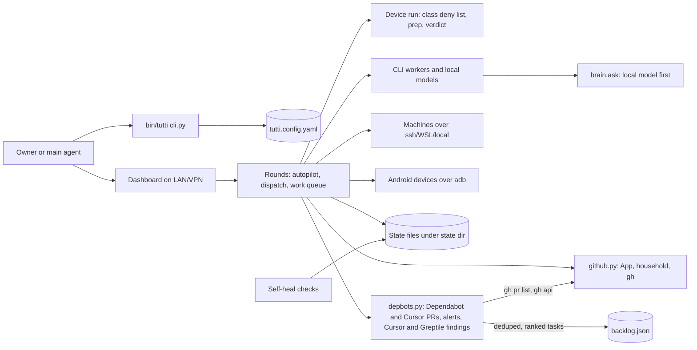
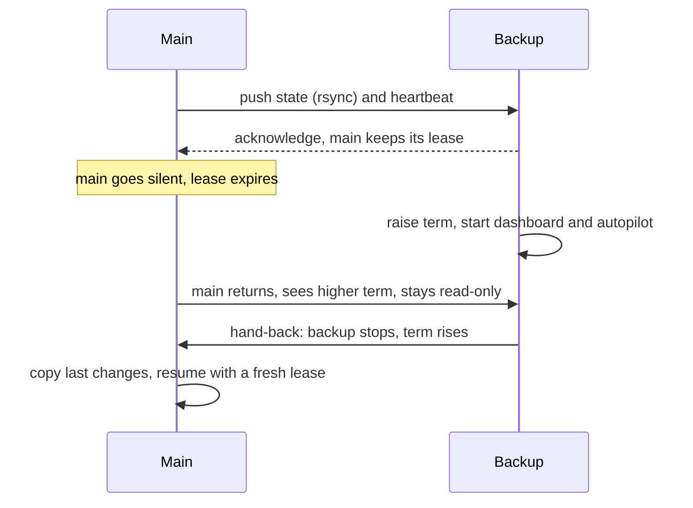
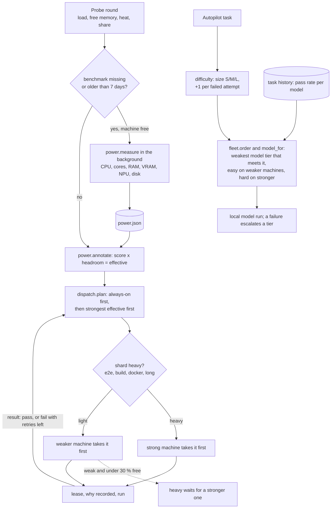
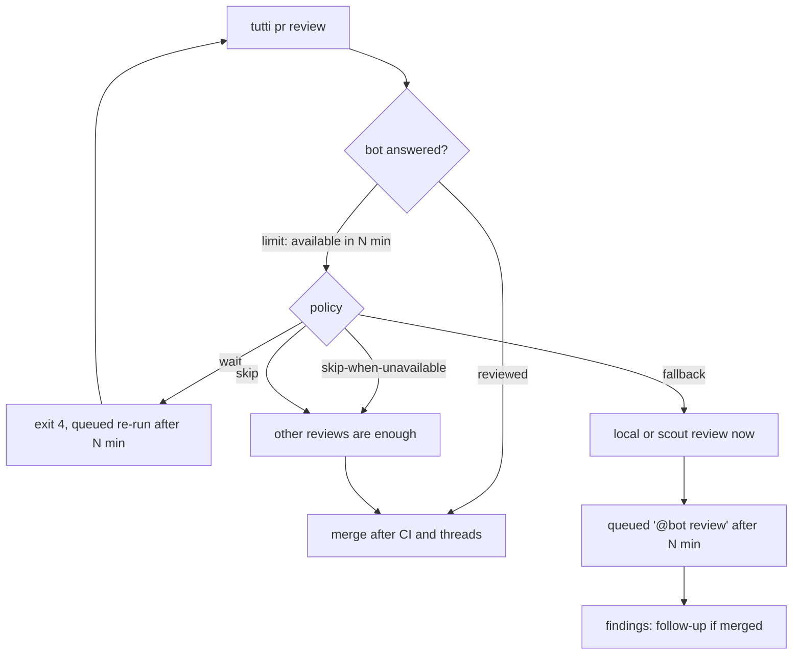
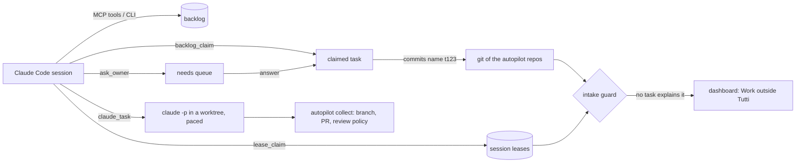
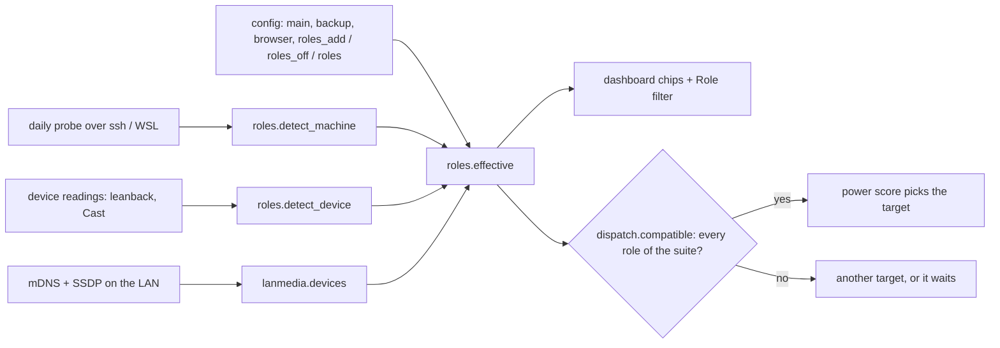
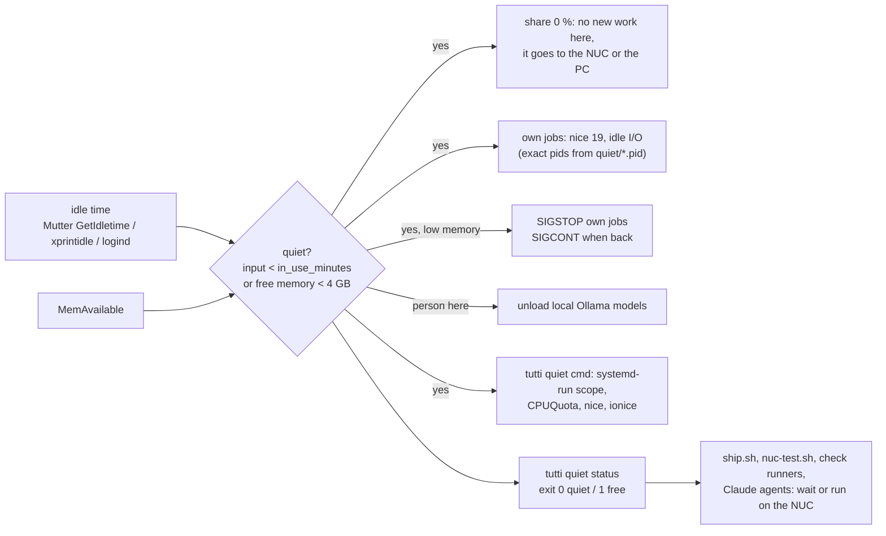

# Architecture

Tutti is a thin layer: a Python package (standard library plus PyYAML) behind one command, and a few bash scripts that
run on the machines. There is no daemon; state is files. The one server besides the local dashboard is a household's
coordinator (docs/HOUSEHOLD.md), and only when several people share machines and projects.

```text
                         tutti.config.yaml  (machines, workers, accounts, ship steps)
                                  |
  orchestrator  ---->  bin/tutti (tutti/cli.py)
   (an agent                |
    or a person)            +-- test     routing.py -> remote.py -> ssh/WSL/local -> scripts/slot.sh -> runner
                            +-- ship     ship.py: format, commit, checks (local or routed), push, deploy
                            +-- usage    pacing.py: windows, targets, verdicts; a JSON-lines log
                            +-- run      workers.py: the brief, then cursor-agent / agy / claude
                            |            delegate.py (--repo): worktree, headless worker, diff, routed checks, report
                            +-- pr       review.py: request reviewers, detect none coming, local fallback review via gh
                            +-- ask, code, agent, translate    local.py, translate.py: Ollama's HTTP API
                            +-- yield, machines, guard, tunnel, quiet, wait
```

## The system at a glance

Each part below has its own page; this is how they fit together.

- **Main and backup machine** ([FAILOVER.md](FAILOVER.md)). One machine is the *main*: it runs the dashboard, the
  autopilot and dispatch. A backup keeps a copy of the state (rsync from the main) and watches the main's heartbeat. When
  the main is gone it takes over under a new *term* with a lease; when the main comes back it hands back. Only the holder
  of the current lease writes (`failover.may_write` gates the autopilot, dispatch and the coordinator), so two machines
  never act at once.
- **Dispatcher** ([DISPATCH.md](DISPATCH.md), `tutti/dispatch.py`, `tutti/workq.py`). Pending work is every test shard
  not yet passed on a project's latest commit, plus queued backlog tasks. Each round, every free device, machine slot and
  worker takes the next item by project priority, under a lease that expires if its holder dies, so the item is retried
  elsewhere.
- **Workers and accounts** ([WORKERS.md](WORKERS.md), [USAGE-PACING.md](USAGE-PACING.md)). A worker is a CLI agent
  (cursor-agent, agy, claude, copilot) or a local model, signed in once by a person on an account. Pacing reads each
  account's quota windows; `tiers.py` picks model and effort by pace, `planner.py` spends the quota that expires first,
  and the unblocker forgives tasks that only hit usage limits.
- **Machines and leases** ([MACHINES.md](MACHINES.md), [FLEET.md](FLEET.md), [DEVICES.md](DEVICES.md)). Machines are
  reached over `ssh`, WSL or locally; Android devices over adb. `routing.py` picks the first fit machine from probes
  (free slots, load, yield flag); `slot.sh` holds a slot lock on the machine. In a household, shared machines are split by
  fair share and leased through the coordinator ([HOUSEHOLD.md](HOUSEHOLD.md)). Presence says which target is here.
- **Brain and local AI** (`tutti/brain.py`, `tutti/local.py`). Every internal use of a model goes through `brain.ask`:
  the best free local model in the household (Ollama) first, a CLI worker only as a fallback. A test fails any module that
  calls a model directly.
- **Self-heal** ([SELFHEAL.md](SELFHEAL.md)). Every few minutes, inside the failover round, a list of checks with a
  repair each (missing needs, signed-out workers, Ollama, tunnels, adb, disk, broken state or config). A repair is done
  and logged; only what a person must do becomes one item in Needs you ([NEEDS.md](NEEDS.md)).
- **Dashboard** ([DASHBOARD.md](DASHBOARD.md), [CHAT.md](CHAT.md)). `tutti dashboard`: a local HTTP server and PWA,
  never on the internet (`netpolicy.py`: LAN or VPN addresses only). Google sign-in names the administrator
  ([AUTH.md](AUTH.md)). It runs the rounds (probes, autopilot, dispatch, work queue) and shows `/api/state`.
- **Config** (`tutti/config.py`, `settings_schema.py`). One `tutti.config.yaml` per user: machines, workers, accounts,
  projects and their tests, ship steps. Settings edits it in place, with backups; every error names its key and the fix.
- **State files** (below). No database: JSON and JSON-lines files under `<state>`, written atomically and fsynced
  (`durable.py`), snapshotted by the watchdog and kept within a size budget (`statebudget.py`).
- **GitHub connection** ([GITHUB.md](GITHUB.md), `tutti/github.py`). One client for every GitHub call: the person's own
  device-flow connection through Tutti's GitHub App, else the household's, else `gh`. No webhooks: Tutti polls with
  ETags and respects the rate limit, so the dashboard stays off the internet.

### Diagrams







## Modules

The public surfaces (the CLI, the HTTP routes, the MCP tools, the config keys) are listed in [API.md](API.md).

| File | Owns |
| --- | --- |
| `tutti/config.py` | Finding (`$TUTTI_CONFIG`, then `$XDG_CONFIG_HOME/tutti/config.yaml`, then the nearest file), loading, defaulting and validating; `write_text` saves through a symlink into the real file, atomically. Every error names its key and the fix. |
| `tutti/roles.py` | Roles of machines and devices: the daily probe, the config's roles, an admin's `roles` / `roles_add` / `roles_off`, each with why; `dispatch.compatible` refuses a target without a suite's `roles:`. `tutti/rolescmd.py` is `tutti machines --roles` and `tutti roles`. |
| `tutti/lanmedia.py` | Media devices on the LAN (AirPlay, Cast, Spotify Connect over mDNS; DLNA over SSDP), scanned once a day, shown under Devices with their roles. |
| `tutti/diskroom.py` | Room on the temp folder and the work disk: low free space or file slots warn (doctor, Machines card) and stop new work. |
| `tutti/configone.py` | One config per user: other copies that differ (doctor, Settings) and their merge into the one in use, each copy then a symlink to it. |
| `tutti/devicecard.py` | One card per Android device on the dashboard: its one status (the pause switch and the idle watchdog folded in), why, what waits on it, its action, its reroute line, plain durations and temperatures labelled by sensor (skin or SoC, battery only when present). |
| `tutti/power.py` | Measured machine power (a short benchmark, weekly), headroom now and the effective power dispatch orders by; heavy shards to strong machines, light to weak; a task's difficulty matched to the weakest local model tier that meets it, escalated after a failure. |
| `tutti/apidoc.py` | docs/API.md's generated parts (CLI, MCP tools, config keys, from the code) and its check that every CLI subcommand, HTTP route and MCP tool is documented (`python3 -m tutti.apidoc --write`). |
| `tutti/routing.py` | Pure fall-over logic over `Probe`s. No I/O, so it is unit-tested exhaustively. |
| `tutti/remote.py` | Transports (`local`, `ssh`, `wsl`), the probe, the tree copy, the runner line, the yield flag. |
| `tutti/pacing.py` | Quota windows, the target time, the verdict and the report. Pure apart from the log file. |
| `tutti/workers.py` | The brief (task, files, project rules, standing rules) and CLI workers. |
| `tutti/local.py` | Local models: ask, rewrite one file, the edit-check-retry loop, yield waits, busy markers. |
| `tutti/translate.py` | Translation with mandatory QA and the import gate. |
| `tutti/ship.py` | The ship sequence and its refusals (wrong worktree, protected branch). |
| `tutti/waiting.py` | Waits on a pid, a file or a log line, always under a timeout. |
| `tutti/files.py` | Files for other machines, the pure part: the secret check, item manifests (SHA-256), the cache's least-recently-used eviction, progress lines. |
| `tutti/transfer.py` | `tutti files` and `--input`: copies items over the machine's transport (rsync, else a resumable stream), verifies them with `sha256sum` there, records them in the machine's cache and keeps it within its budget. |
| `tutti/autopilot.py` | `tutti autopilot`: the pure plan (pace, room, heat, `max_parallel`, the ladder), failure signatures, parking, the retry brief; dispatch, collect and publish (branch, draft pull request). |
| `tutti/backlog.py` | `tutti backlog`: the task queue in `<state>/backlog.json` under a lock, and its safe sources (FEEDBACK, `TODO(owner)`, `gaps`). |
| `tutti/conduct.py` | `tutti conduct`, `tutti main` (`<agent|auto>`), `tutti handoff`: the main agent's choice and order (`main.agent: auto` + `main.preferred`), the instruction file, the `tutti` shim on its PATH, the watch (panic, limit, switch), the handoff note, the local model's command loop, and automatic MAIN AGENT ROLE hand-off (preferred while it has room, else `main.fallback`; restore after reset; chat note + `tutti connect`). |
| `tutti/projects.py` | The dashboard's projects: a folder's repository from its `.git` files, jobs tagged by project, a read-only look at every machine's processes in git repositories and its GPU, a WSL machine's Windows side over plain ssh. |
| `tutti/state.py` | The dashboard's state as plain data: accounts and pacing, machines, workers, jobs, the summary. Probes are passed in. |
| `tutti/delegate.py` | `tutti run --repo` and `tutti runs`: the worktree, the headless worker, the diff, the checks (never stopping at the first failure), DENIED tool calls, the coverage note and the report. |
| `tutti/review.py` | `tutti pr review`: asking Copilot, CodeRabbit and Greptile through `gh`, the review policy (wait, fallback, skip, skip-when-unavailable) with its re-request queue (run by the autopilot round), the rounds per reviewer, reading their answers and limits, skipping a reviewer whose account reads 100 % until its reset, the local fallback review posted as a comment. `gh` is passed in for tests. |
| `tutti/helper.py` | The reading helper: the per-install key, the bookmarklet page (`/helper`) and the page script for an orchestrator's browser tool; the parser both use is `tutti/web/helper-parse.js`, the bookmarklet's wrapper `tutti/web/helper-bookmarklet.js`. |
| `tutti/releases.py` | A project's open pull requests (`projects.<n>.repo`, through gh): a release in progress first, CI and review state, cached per repository. |
| `tutti/depbots.py` | Dependency bots and vulnerability reports (docs/SECURITY-INTAKE.md): open Dependabot and Cursor dependency pull requests, Dependabot and code-scanning alerts and Cursor's and Greptile's security review comments read through `gh` outside the backlog's lock; pure classification, grouping of trivial bumps, dedupe and ranking; tasks queued and dropped when the pull request closes or the alert is fixed; `tutti security` and the dashboard card. |
| `tutti/scouts.py`, `tutti/scoutcmd.py` | Scouts (helpers that are not workers, docs/SCOUTS.md): config checks, the webhook POST (the key only in its header, from an environment variable or stdin), the issue and its answer through `gh`, the pure plan paced by the scout's account, the round and the view; `scoutcmd.py` is `tutti scout`. |
| `tutti/trial.py` | A scout's review trial: asked beside `tutti pr review`, findings per reviewer, real or noise, the verdict. |
| `tutti/scrub.py` | What telemetry may keep, pure: categories only as field values; free text with home folders, hosts, IPs, e-mails, URLs, tokens, keys and quoted fragments replaced. |
| `tutti/telemetry.py`, `tutti/sentry.py`, `tutti/telemetrycmd.py` | Telemetry (docs/TELEMETRY.md): local events and their rotation, consent, the DSN, crash and failure events, the outbox and its flush; Sentry's envelope API and the custom endpoint; the CLI's entry wrapper (`cli.entry`, used by `bin/tutti`; `cli.main` records nothing) and `tutti telemetry`. |
| `tutti/insights.py` | The local events summarised, pure: most used, slowest, most failing, wasted quota, stall and park causes, crashes. |
| `tutti/needs.py` | The needs-input queue: one question per parked task, answers that resume it, batched delivery at work or off work for those who opt in (threshold, urgent, quiet hours), per-user settings with audit, `/api/needs`. |
| `tutti/welcome.py` | Welcome back: away to back from the owner's mode, presence and dashboard visits; the summary's facts per role, the needs-you list, the template and the local model's words; `/api/welcome`. |
| `tutti/aiassist.py` | AI assist (opt-in): the local self-analysis into tasks, failure classes and briefs with fallbacks, auto-tuning with undo, the spare-only research watches, the dashboard card. |
| `tutti/triage.py`, `tutti/selfimprove.py` | Sentry triage watches per project and their `TUTTI-TASK` lines; self-improvement's pure gates (tasks, pull request base, merge, release, daily room), the local analysis, the review/merge/release round and the dashboard lane. |
| `tutti/users.py`, `tutti/householdcmd.py` | Who this Tutti works for (docs/HOUSEHOLD.md): the name, the random id in `<state>/user.json` and its hash (the only way telemetry names a user), the accounts whose spare room is shared, the membership in `~/.config/tutti/household.json` (600); `householdcmd.py` is `tutti user` and `tutti household`. |
| `tutti/failover.py`, `tutti/failovercmd.py`, `tutti/statebudget.py`, `tutti/watchdog.py` | The backup main machine (docs/FAILOVER.md): the pure core (election, the term and lease protocol, the hand-back, the failover list) and its edge (rsync and ssh from the main, the backup's dashboard by recorded pid, the user services); the state's size against its budget and its trim; the watchdog's snapshots and repairs. `failover.may_write` gates the autopilot, dispatch and the coordinator. |
| `tutti/household.py`, `tutti/coordinator.py`, `tutti/sharing.py` | The household (docs/HOUSEHOLD.md): the pure core (the join code, the derived token, signed requests, members, leases, shared backlogs and their dedupe); the coordinator's HTTP service and state file and the members' signed client (no proxy, a 3 s timeout, `Unreachable` means work alone); a member's round on its shared repos (one `/hh/sync` per autopilot round outside the backlog's lock, the shared tasks mirrored in, the ones it may not start held: leased by another member, or all of them while the coordinator is unreachable). |
| `tutti/mainmachine.py`, `tutti/manage.py`, `tutti/web/userstab.js` | A user's main machine: `tutti move` of their own Tutti, the server's "only yourself" check, presence while a client is connected. Acting for a member: the admin's Users tab queues an action at the coordinator (`/hh/act`, audited), the member's Tutti runs it on its round (schedule, main agent, main machine, connect, pairing, machine use, pause, update). |
| `tutti/hhjobs.py` | Compute on another member's machine with no login there: the member pushes a WIP ref and sends a signed job, the owner's Tutti claims it, runs it in a sandboxed worktree with its own `tutti test --on <m>` (a container unless `household.member_shell`) and returns the exit code and output through the coordinator. |
| `tutti/netpolicy.py` | Never on the internet: the addresses a household's coordinator, the dashboard and `tutti mcp --http` may listen on and join links may name (localhost, RFC 1918, 100.64/10, fc00::/7, WireGuard interfaces); `auto` binds; a public address or a wildcard raises `PublicAddress` with the fix. |
| `tutti/fairshare.py` | Fair shares of shared machines, pure: weighted water-filling, interactive before background, the starvation rule, hour weights from a member's 7 x 24 profile, the household plan, Jain's index; the member's grant cache and `limit` (what a shared machine leaves free for it). `sharing.limit_items` and `sharing.limited_probe` apply it to the autopilot's machines and to `tutti test`'s routing. |
| `tutti/chat.py`, `tutti/chatrun.py`, `tutti/web/chat.js` | The dashboard's Chat (docs/CHAT.md): conversations per user in `<state>/chat/` (600), requests parsed into the MCP tools' calls, the role checks, the model order, the facts and the built-in answers (pure); the answer threads, Ollama and CLI streaming, Undo, the audit lines and `POST /api/chat` (I/O); the page's safe Markdown and composer. |
| `tutti/dispatch.py`, `tutti/workq.py` | Keep busy: the pending-work model (shards not passed on the latest commit, queued tasks), leases on devices, slots and workers; the compute work queue by project priority. |
| `tutti/devclass.py`, `tutti/prep.py`, `tutti/shards.py`, `tutti/winsession.py` | A device run's safety: per device class deny lists (a TV never gets `wm size`, rotation or `cmd device_state`), prep and restore (kept items put back), a run's verdict (no test run is a FAIL; requeue only after the runner started); a Windows UI suite in the logged-on user's desktop session. |
| `tutti/brain.py` | Tutti's own AI, local first: the one `ask` every internal model use goes through. |
| `tutti/selfheal.py` | The self-heal checks and repairs, `<state>/selfheal.jsonl`. |
| `tutti/github.py`, `tutti/githubcmd.py` | The one GitHub client (device flow, the App, ETags, rate limit) and `tutti github`. |
| `tutti/tiers.py`, `tutti/planner.py`, `tutti/unblocker.py` | Model and effort by pace; spending the quota that expires first; clearing blocked or limit-only work. |
| `tutti/durable.py`, `tutti/presence.py` | Power-off-safe writes of state files; whether each machine, device and model server is here. |
| `tutti/dashboard.py`, `tutti/dashtelemetry.py`, `tutti/web/` | `tutti dashboard`: the 127.0.0.1 HTTP server, background probes, `/api/state` and the PWA shell. |
| `scripts/slot.sh` | The slot queue, copied to each machine on every run. |
| `scripts/memguard.sh`, `quiet.sh`, `tunnel.sh`, `wsl-run64.sh` | The memory guard, quiet runs, the tunnel loop, the WSL shim. |

How a rate-limited review bot is handled (`review.coderabbit`, `review.greptile`):



## All work through Tutti

Every Claude Code session in the household, and every other main agent, does its work as a Tutti task (`tutti/intake.py`,
`tutti/claudework.py`, [INTAKE.md](INTAKE.md)). A session claims a backlog task or schedules one for a Claude worker,
leases the machine or device it uses, asks the owner through the needs queue and closes the task; the intake guard
reads the autopilot repos' git and the leases and shows what no task explains.



## Roles and dispatch



## How `tutti test <track> '<cmd>'` flows

1. The config gives the routing order. Machines are probed lazily, in order: free slots, load, cores, yield flag.
2. The first fit machine wins. If none is fit, the run queues on the first reachable machine whose flag is down.
3. For a remote machine: the tree's `HEAD` is pushed to a bare repository there, the tree is copied with rsync
   (incremental, the config's excludes: no secrets, no build output), and the copy gets a shallow git repository at
   that commit, so tests that ask git still work.
4. The command runs behind `slot.sh`: it takes a free slot lock, waits for free memory, then starts the runner
   (a container capped in memory and CPUs, or plain bash).
5. The command's exit code comes back unchanged.

## Quiet mode

A person at a computer comes first. `tutti/share.py` reads the idle time (GNOME's idle monitor over the session D-Bus on X11
and Wayland, else `xprintidle`, else logind's idle hint; a locked screen reads as away) and `tutti/quietmode.py` acts on it.



The dashboard's probe loop runs `guard_round` every probe. It only touches processes Tutti started itself, by the exact pid
`scripts/quiet.sh` writes beside its log, and their children; it never matches a process by name. Work Tutti did not start
(an agent's own docker or Playwright runs) is not stopped: those tools must ask first. **For Claude and other agents:**
before a heavy local run (tests, docker, builds, a local model), run `tutti quiet status`; on exit 0 run it on another
machine (`tutti test`, `ssh nuc`) or wait with `tutti quiet wait 1800`, and wrap what must run here in `tutti quiet <cmd>`.
Settings: `quiet.reserve_gb` (4), `quiet.cpu_quota` (`200%`), `quiet.ollama` (`http://127.0.0.1:11434`),
`machines.<m>.in_use_pct` (0) and `in_use_minutes` (5).

## State

- `<project.state>/usage.jsonl` (or `usage.log`): one line per usage reading.
- `<project.state>/llm-busy-<pid>`: a live local-model job; low-priority jobs wait for these to go.
- `<project.state>/tunnel-<worker>.pid|.log`, `quiet/*.log`, `ship-*.log`, each run log with its result `<log>.rc` and
  command `<log>.cmd`; `waits/<pid>.json` while a `tutti wait` runs. `tutti dashboard` reads all of these.
- `<project.state>/depbots.json`: the last read of dependency pull requests and vulnerability reports per repo (counts, worst severity, links, what needs the owner).
- `<project.state>/scouts.json`: every scout request (question, watch, review), its issue and answer; never a key or URL.
- `<project.state>/review-trial.json`: the review trial's pull requests, findings and verdict.
- `<project.state>/telemetry/`: `events.jsonl` (rotated), `consent.json` (sending yes or no, the random install id),
  `outbox.jsonl` (what waits to be sent, only with consent), `send.json` (the last send).
- `<project.state>/user.json`: this user's random id, the name and the `share_spare` switches set by `tutti user`.
- `~/.config/tutti/household.json` (600): the household membership and the user's token; absent for a household of one.
- `<project.state>/self-improve.json`: the switch, the last analysis, reviews asked, merges and releases.
- On each machine: `<root>/<track>/` (the copy), `<root>/repo.git`, `<root>/tutti-slot.sh`, the slot lock files and the
  yield flag file.

## Design rules

- **Config, not code.** No host, path, account or model name is built in.
- **No secrets.** Tutti never reads, stores or sends a credential; workers sign in by themselves, once, by a person.
- **No secret in an environment** (`tutti/secretenv.py`, t116). The few secrets Tutti uses (the Grok scout's webhook key)
  live in files of mode 600 (`~/.config/tutti/grok.env`) and are read at the point of use. Every command drops them from its
  own environment at start, so a worker, a restart, self-update, self-heal or failover inherits none; the dashboard runs
  itself again without them; whatever shows a process's environment masks values whose names look like keys, tokens or
  secrets. **Agents: never print a process environment** (`env`, `printenv`, `/proc/<pid>/environ`, `ps e`): use
  `tutti doctor` to inspect.
- **Refuse early, say why.** Every refusal names what happened, why, and the next step.
- **Pure core.** Routing, pacing and validation are pure functions; I/O sits at the edge and is thin.

### Dashboard drain primitive (not yet activated)

`drain.Gate` tracks work registered in one process. Beginning a drain atomically rejects new registered work, lets
existing work finish, and returns a token; a bounded wait reports success only while that same drain is active. Cancel
reopens admission without stopping work, and stale tokens cannot cancel a newer drain. Timeout does not reopen it.

This is a building block only: it does not cover any entry point until explicitly wired, route connections, preserve
streams, fence another host, exclude older dashboard versions, or supervise a process. In particular, a zero count is
not evidence that the dashboard is safe to restart. A future supervisor must register all relevant work and establish
exclusive admission, mixed-version exclusion and live stream/job ownership before relying on a drain. A successful
wait is only a snapshot: the supervisor must retain exclusive authority from that point through routing and handover,
so no other actor can cancel the drain or reopen admission in between.

### Proposed dashboard handover boundaries (not implemented)

The dashboard currently owns both the HTTP server and long-lived work. `Collector.start()` launches the probe loop,
sleepwatch, intake and needs backfill; `acting_rounds()` initiates update, autopilot and work queue, dispatch, scouts,
telemetry, AI assist, unblocker, welcome, needs, role handoff and household jobs. Update, AI assist and unblocker can
launch further background threads. HTTP handlers can also start setup, move, dispatch, controls and Chat work. Chat
`Engine.send` owns its answer thread, model subprocess and event list; confirm, undo and plan operations can run tools,
and `_follow` can only find jobs in that engine. Work queue, setup and move start subprocesses. A separate process
session alone does not establish survival when a service manager stops a shared cgroup. The complete admission audit
must also include every tool reached transitively from the handlers and rounds, and direct CLI/MCP writers; this list is
not a claim of exhaustive coverage.

A safe design needs a stable owner outside the replaceable HTTP/frontend generation. The owner admits and tracks Chat
jobs, their event journals, tool operations and background rounds; one fenced scheduler owns acting rounds. A stable
listener or gateway authenticates and routes requests to that owner and to a healthy frontend generation. Keep the
owner and its children in a lifecycle/cgroup that an HTTP generation restart cannot stop. During transition, fence all
legacy instances and other hosts, prevent duplicate schedulers and new untracked work, health-check the replacement,
then switch routing while existing jobs and streams remain attached to the stable owner. If fencing or health checks
fail, leave or restore the old generation without stopping its work. The gate in `drain.py` only helps if every relevant
admission is actually registered and the supervisor holds exclusive authority through the transition.

`replay.ReplayLog` is an unconnected in-process prototype for a job owner's ordered event journal. A client could keep a
owner-generation and job-scoped sequence cursor and replay missed events after reconnect; a bounded retention gap is explicit and must trigger
a snapshot/resynchronization, never silent skipping. The prototype is neither a durable journal nor an authenticated
API, and it does not wire the cursor into Chat or keep a process alive. The bound covers event count and UTF-8 JSON payload bytes, not all Python allocation or the temporary encoding of an
incoming event or concurrent decoded reads; upstream input limits, bounded concurrency and resource controls remain necessary. A saved conversation may lag the
stream, so a gap does not guarantee exact recovery. A production design still needs authorization on every follow, atomic snapshot/cursor resynchronization, backpressure,
client retry behavior, crash recovery, and tests spanning process and gateway transitions. Until those prerequisites are
met, neither a drain nor event replay makes an instant live dashboard restart safe.

#### Stream access and identity boundary (design only)

The stable owner must bind each job to its authenticated user and an unguessable job identifier and owner generation.
The generation and cursor identify a replay position; they do not grant permission. A gateway must authenticate each
send, follow, stop and snapshot request, then the owner must independently authorize that verified subject against the
job's owner and current policy, including revocation and cross-user denial. The owner must accept identity assertions
only over an authenticated, private local channel from the gateway, with a protocol that prevents untrusted clients from
impersonating it. A restarted gateway must reauthenticate followers; it must not trust a browser-provided subject, a
previous connection, a guessed job identifier, or possession of a cursor. Logs and errors must not expose other users'
stream content. Admin cross-user access must be explicit policy, not an inference from the cursor.

These requirements are not implemented by `ReplayLog`; it has no principal, transport, authentication or authorization.
Integration needs adversarial cross-user, revocation, reconnect and gateway-restart tests before it can be enabled.

#### Draft Chat replay adapter (not activated)

The draft `follow_cursor` adapter can attach a bounded replay log to an existing in-process Chat `Job`. It defaults off;
the dashboard does not enable it. Its events carry
an owner-generation and sequence; the adapter checks the request's authenticated subject against the job owner before
checking the cursor and requires the conversation and message to exist at request time. Another subject receives the same
unavailable response as for an unknown or deleted job. Gaps, bad generations
and unrecordable events fail explicitly, while the original unbounded stream remains available for compatibility. Replay
is available only while this same Engine keeps the Job; the browser has not been changed to consume this adapter. A client
must not render partial replay as complete when it receives a replay error.

This adapter is a testable bridge, not the stable owner or a gateway. In particular it does not independently authenticate
IPC, bound the old `Job.events` list or transient serialization,
persist journals, or survive an Engine restart. It adds another in-memory copy of events and must not be activated in
production until a bounded migration, revocation semantics and the supervisor/gateway lifecycle are reviewed and tested.

The draft cursor adapter rechecks the original HTTP session, role, job owner and message existence before each emitted
event; an idle stream wakes at most once per second to check again. Session lookup failures close it. Bytes already handed
to the socket cannot be recalled, and a change can race between a check and the following write; the check does not make
revocation instantaneous. This is not a trusted gateway-to-owner protocol and does not protect the legacy follow stream.
It remains disabled until those lifecycle and authorization boundaries are addressed.

#### Private owner channel experiment (not activated)

`owneripc` is an isolated, bounded JSON framing and read-only replay experiment over an already connected socket. A test
starts a separate process holding a real Chat `Job`, then starts two sequential gateway processes sharing a socketpair
endpoint; the second can read the same owner's replay after the first exits. The owner compares the gateway-asserted
subject to the job owner and gives other subjects and missing jobs the same error. Frames have a 64 KiB encoded cap and
invalid or truncated frames terminate the channel. No dashboard, listener or service manager invokes this code.

The connected descriptor is a capability supplied only to a trusted gateway by a trusted supervisor: the protocol does
not authenticate the asserted subject or a peer, and anyone holding the descriptor can impersonate any user. This is not
an authorization boundary for an untrusted caller. A real design needs a supervisor that creates and protects endpoints,
enforces exactly one gateway descriptor owner at a time, closes all inherited copies and fences the previous gateway
before replacement. Two concurrent gateways can interleave frames or receive each other's replies, causing cross-user
disclosure; this prototype has no correlation IDs or cross-process serialization. The supervisor must also bind verified
and revocable sessions to assertions, revalidate jobs and
messages, and isolates process lifetimes and cgroups. This prototype has no production process startup, reconnection,
concurrent request multiplexing, deadlines, revocation, store-backed deletion checks, stream tailing, durable recovery or
live routing. An oversized replay batch fails closed even if each event would fit individually; pagination is needed for recovery.
The frame cap bounds encoded frames, not temporary JSON allocations or concurrent callers. The sequential
replacement test is not proof of safe handover or crash continuity.

#### Gateway replacement fence experiment (not activated)

`gatewayfence.GatewayFence` is an isolated owner-side experiment for distinct, connected gateway sockets. It serializes
reply sends and compare-and-swap replacement under one process-local lock. Once replacement returns, no further replies
will be sent through this fence to the old endpoint; bytes already sent remain readable. Stale replacement attempts fail,
a duplicate descriptor for the same endpoint is rejected, and a send failure fences a channel whose framing may now be
partial, including duplicated descriptors for the same endpoint. Poisoned endpoint identities remain in memory for the
fence lifetime; inode reuse can therefore reject a new endpoint conservatively and requires lifecycle management. Replies
carry a request identifier. A bounded socket send timeout limits ordinary blocked sends, but does not
bound arbitrary callback/serialization work or lock starvation. Tests cover a send racing replacement, old-peer denial,
foreign-subject denial, duplicate descriptors and send failure.

This does not authenticate gateways or user assertions, prove same-UID isolation, establish a live supervisor, create or
secure the endpoints, manage shared descriptor copies, serialize unrelated code using the socket, or stop an attacker who
can call the supervisor API. The trusted owner must exclusively control this object and all writes to these channels; the
supervisor must ensure endpoints and inherited descriptors cannot leak. The prototype is process-local, is not connected
to `owneripc.serve` or the dashboard, and does not implement durable recovery, stream tailing or production handover.

#### Descriptor handoff experiment (not activated)

`ownersupervisor` experiments with an owner process that retains a real Chat `Job` while a trusted supervisor passes a
new connected Unix stream endpoint over a private `SOCK_SEQPACKET` control socket using `SCM_RIGHTS`. A serial owner loop
checks an expected generation, switches its `GatewayFence` to the new endpoint, closes its old copy, and acknowledges
the new generation. It processes requests through the fence and drops endpoints with broken framing or I/O. An isolated
subprocess test checks stale replacement refusal, old-gateway EOF after acknowledged replacement, owner survival, and
subject comparison. The supervisor must close its own copy of the passed endpoint; otherwise the old peer may remain open.

This experiment requires Unix `SOCK_SEQPACKET` and `SCM_RIGHTS`; other platforms are unsupported. It has no production
launcher, authenticated supervisor or gateway, permission checks, stream tailing, session revocation, crash recovery or
service-manager isolation. The control descriptor is an authority-bearing capability: anyone who gets it may replace a
gateway and impersonate subjects. The gateway must authenticate users and prevent forged assertions; a socket or same
UID does not establish that trust. The supervisor must protect and close all endpoint copies and serialize control access.
A previously emitted reply can remain in buffers, a slow partial request can delay control processing until the total one-second frame deadline, and termination of the
control channel currently terminates this experimental owner. If an acknowledgement is lost, a caller holding the original handoff ID can query the current generation and ID over
the same ordered control connection. Reconciliation reports applied, not applied, conflict or unknown; unknown and
conflict must fail closed. This only works with one trusted serialized caller, a still-live owner and the same FIFO
connection. Status is a snapshot, not authority to proceed if another actor can access the control channel. Loss or
replacement of that channel, supervisor crash and owner restart still have no recovery protocol. No live Tutti service uses
this code, and a successful test is not evidence that dashboard restart or handover is safe.

#### Owner-side session authorization experiment (not activated)

The isolated owner channel can resolve the browser session against Tutti's existing session and user stores on each
follow request, reject pending or missing users, and compare the resolved subject with the job owner. A gateway-provided
subject is ignored. Missing, expired, revoked, malformed or unreadable sessions are denied without returning the token;
no authorizer means deny. Tests use temporary fake users and sessions and verify cross-user subject spoofing and a session
revocation while the isolated owner process remains running. The gateway must supply the actual browser session over the
private channel; the session ID is a bearer secret and must never appear in logs, arguments, crash dumps or untrusted
traces. The descriptor and process memory require appropriate OS protection. Each request is rechecked; this experiment does not authorize or revoke an
already-open streaming response and does not atomically prevent a state change between check and reply.

Threat model: local processes able to act as the Tutti service UID are trusted under the existing deployment model. Such a
process can modify Tutti's session/user state or obtain trusted process capabilities, so this experiment does not protect
against it. A private inherited socket descriptor can restrict access under normal OS controls, but neither a distinct UID
nor descriptor isolation against other UIDs has been demonstrated here; same-UID identity, untrusted peer isolation, a
secure supervisor, capability leakage prevention, deletion checks and end-to-end gateway/session authorization remain
required before activation. Existing unauthenticated demonstration helpers are test-only and must not be exposed.
